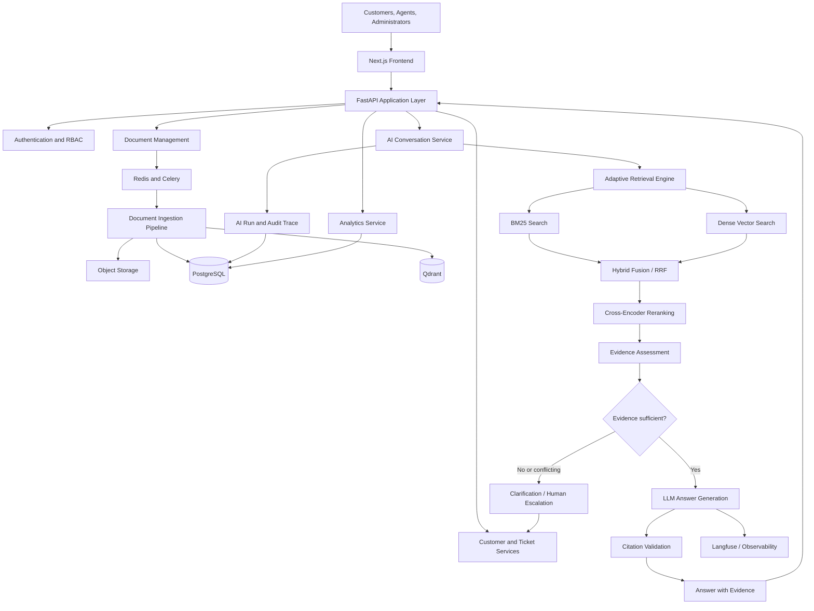
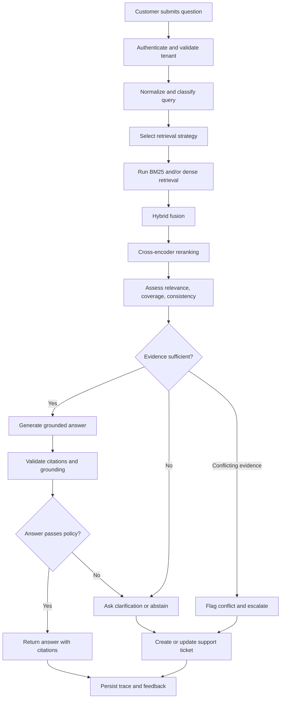
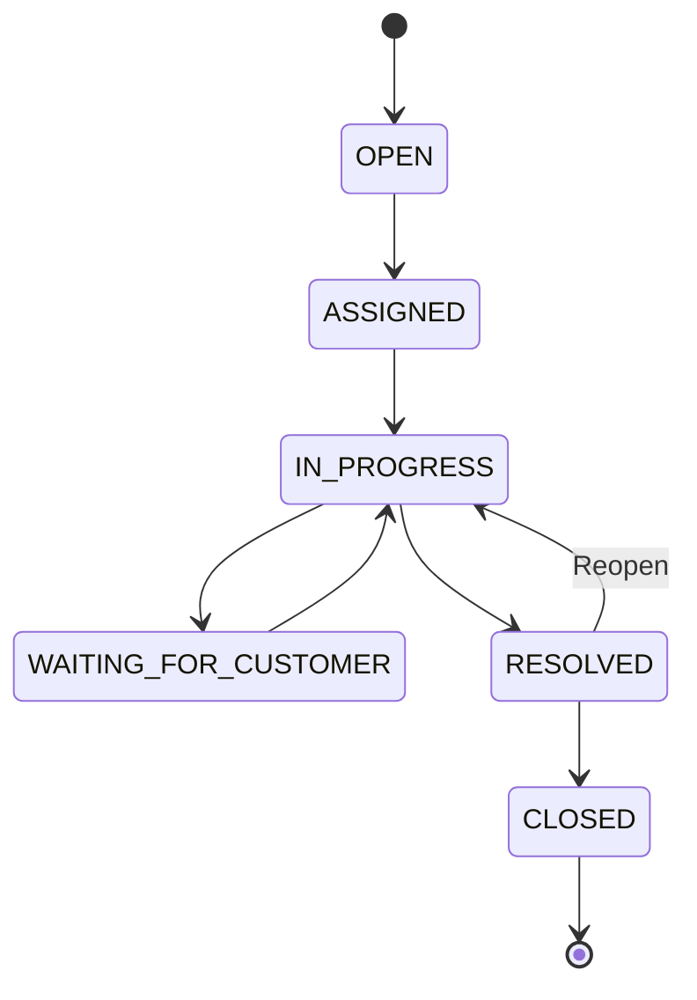
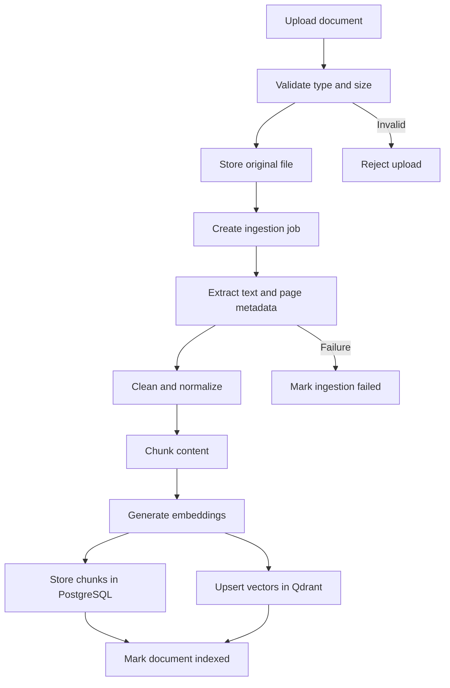
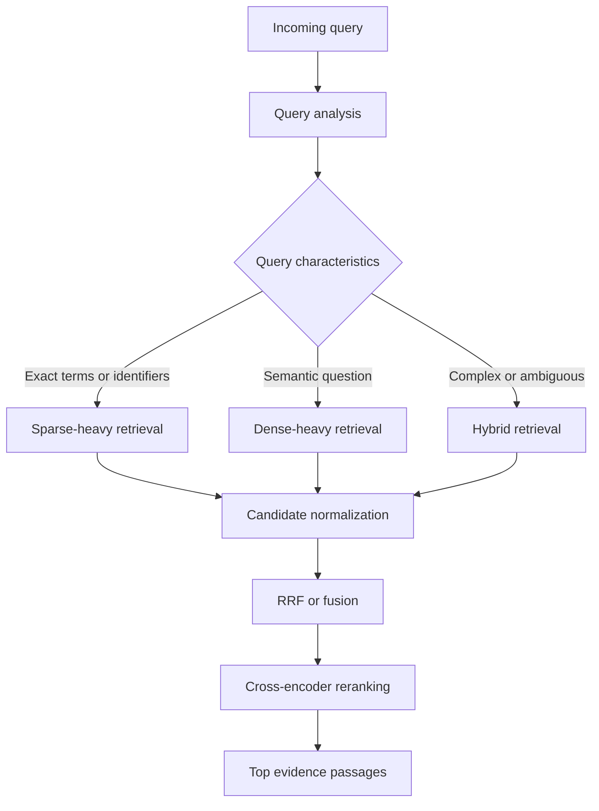
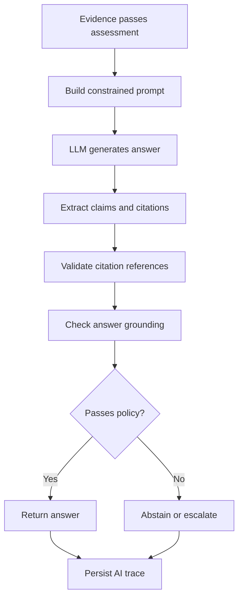
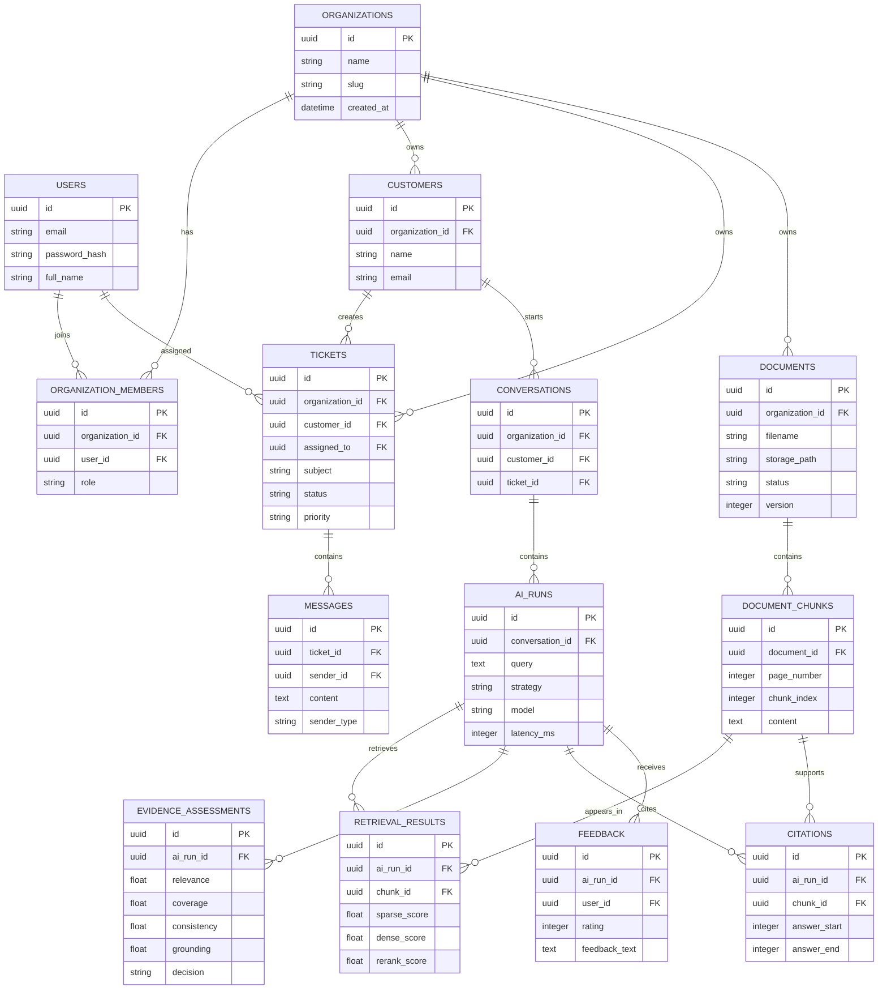

# SupportIQ --- Implementation Plan

## Uncertainty-Aware AI Customer Support & Business Intelligence Platform

**Project duration:** 6--8 weeks
**Target roles:** Full-stack Developer, Backend Developer, AI Engineer,
Applied AI Engineer
**Project type:** Production-oriented SaaS application +
research-oriented AI system
**Recommended architecture:** Modular monolith with a separately
organized AI engine

---

## Table of contents

1. [Executive recommendation and product
   vision](#1-executive-recommendation-and-product-vision)
2. [Technology stack](#2-technology-stack)
3. [System architecture](#3-system-architecture)
4. [Development modules](#4-development-modules)
5. [Database schema](#5-database-schema)
6. [Backend API design](#6-backend-api-design)
7. [Frontend application design](#7-frontend-application-design)
8. [Eight-week development roadmap](#8-eight-week-development-roadmap)
9. [GitHub repository structure](#9-github-repository-structure)
10. [Research contribution and
    evaluation](#10-research-contribution-and-evaluation)
11. [Interview and engineering demonstration
    points](#11-interview-and-engineering-demonstration-points)
12. [Resume presentation](#12-resume-presentation)
13. [Portfolio completion checklist](#13-portfolio-completion-checklist)
14. [Implementation priorities and final
    recommendations](#14-implementation-priorities-and-final-recommendations)

---

# 1. Executive recommendation and product vision

## 1.1 Project recommendation

Build **SupportIQ**, an AI-powered customer support and business
intelligence platform.

SupportIQ should be more than a chatbot. It should be a multi-tenant
SaaS product that enables organizations to manage customers and support
tickets, maintain a searchable knowledge base, and use an AI assistant
that answers questions only when it has sufficient supporting evidence.

The distinguishing technical contribution is an **uncertainty-aware
adaptive Retrieval-Augmented Generation (RAG) pipeline**. It should:

- Retrieve relevant information from organization-specific documents.
- Adapt retrieval strategy to the query.
- Rerank retrieved evidence.
- Assess relevance, coverage, and consistency.
- Generate answers grounded in retrieved evidence.
- Cite the original documents and page locations.
- Ask for clarification or abstain when evidence is insufficient.
- Escalate unresolved or risky questions to a human support agent.
- Record execution traces for evaluation and auditing.

This project complements an existing AI hiring automation project by
demonstrating a different product domain and a broader range of
full-stack and AI engineering capabilities.

## 1.2 Product scenario

An organization uploads its product documentation, FAQs, technical
manuals, refund policies, terms and conditions, and internal
knowledge-base articles.

A customer asks:

> What happens if I cancel my subscription after making a payment?

SupportIQ should:

1. Authenticate the customer and identify the organization.
2. Understand and classify the question.
3. Search the organization's knowledge base.
4. Retrieve relevant passages using sparse and dense retrieval.
5. Combine and rerank the results.
6. Assess whether the evidence is relevant, sufficient, and consistent.
7. Generate a grounded answer if the evidence passes the decision
   policy.
8. Display citations linked to the source document and page.
9. Ask a clarifying question, flag a conflict, or escalate if evidence
   is insufficient.
10. Record the complete AI execution for auditing and evaluation.

Administrators should also be able to inspect ticket volume, response
times, unresolved issues, common support topics, AI answer quality, and
escalation rates.

## 1.3 Main product objectives

---

Objective Expected capability

---

Full-stack application Responsive, multi-tenant SaaS
platform

Backend engineering Secure APIs, background jobs,
WebSockets

AI engineering Hybrid retrieval, reranking, RAG,
uncertainty assessment

Trustworthiness Citations, abstention, conflict
detection, audit traces

Research Reproducible experiments and
baseline comparisons

Production readiness Docker, tests, CI/CD, logging,
monitoring

---

## 1.4 Product scope

**In scope for the 6--8 week MVP:**

- Authentication and organization management.
- Role-based access control.
- Customer and ticket management.
- Real-time ticket messaging.
- PDF, DOCX, TXT, and Markdown ingestion.
- BM25 and dense retrieval.
- Hybrid retrieval and reranking.
- Evidence assessment and citation-backed generation.
- Human escalation and abstention.
- Basic analytics and AI execution inspection.
- Benchmark evaluation and deployment.

**Out of scope for the initial release:**

- Complex multi-agent orchestration.
- Large-scale enterprise billing.
- Native mobile applications.
- Sophisticated workflow designer.
- Extensive CRM integrations.
- Production-grade multi-region infrastructure.

These can be considered after the core system works reliably.

## 1.5 Product interface reference

Use the following visual direction when creating the actual UI. These
are design briefs, not screenshots of a completed product.

---

Screen Image/design brief

---

Admin dashboard Enterprise SaaS dashboard with
sidebar, ticket KPIs, line charts,
status distribution, and AI
performance cards

Agent workspace Support inbox with ticket list,
customer details, conversation
thread, and AI response suggestions

Knowledge management Document upload area, indexed
document table, ingestion status,
and search preview

Customer chat Clean conversational interface with
source citations and a visible
human-support option

AI evaluation Experiment comparison dashboard
with Recall@K, nDCG, faithfulness,
ECE, and latency charts

AI execution inspector Trace view showing query, retrieval
candidates, ranking scores,
evidence decision, generated
answer, and citations

---

Suggested image prompts for producing consistent UI mockups:

- `SupportIQ admin dashboard, enterprise SaaS, clean white background, navy sidebar, blue accent, ticket analytics, professional data visualization, desktop web app, 16:9`
- `SupportIQ customer support agent workspace, ticket inbox, customer profile, conversation timeline, AI suggested response panel, enterprise SaaS UI, 16:9`
- `SupportIQ AI execution inspector, retrieval trace, ranked evidence cards, confidence and abstention decision, citations, modern developer dashboard, 16:9`

---

# 2. Technology stack

Use a stack that supports modern web development, robust backend
engineering, and reproducible AI experimentation.

---

Layer Recommended technology Responsibility

---

Frontend framework Next.js Application routing and
UI

Frontend language TypeScript Type safety

Styling Tailwind CSS Responsive styling

UI components shadcn/ui Accessible reusable
components

Backend FastAPI REST APIs and AI
integration

Backend language Python Application and AI
services

Relational database PostgreSQL Primary system of
record

ORM SQLAlchemy Database persistence

Migrations Alembic Schema versioning

Vector database Qdrant Dense vector search

Sparse retrieval BM25 / PostgreSQL Keyword retrieval
full-text search

Cache and queue broker Redis Caching and task
coordination

Background workers Celery Document ingestion and
async jobs

Object storage S3-compatible storage / Original uploaded
MinIO documents

Embeddings Sentence Transformers, Text embeddings
BGE-small-en-v1.5

Reranking Cross-encoder reranker Evidence ranking

LLM runtime Ollama or hosted model Answer generation
API

Evaluation RAGAS + custom metrics RAG quality evaluation

Observability Langfuse LLM tracing and
monitoring

Containers Docker / Docker Compose Reproducible
environments

CI/CD GitHub Actions Automated checks and
deployment

---

### 2.1 Model and infrastructure choices

Start with a compact embedding model and a locally runnable LLM. Keep
model selection configurable so that experiments can compare models
without rewriting application logic.

The system should support:

- Local inference through Ollama.
- Optional hosted LLM providers through a provider abstraction.
- Configurable embedding and reranking models.
- Model version and configuration logging.
- Separate development, evaluation, and production configurations.

Do not commit API keys, credentials, customer documents, or private
evaluation data to GitHub.

---

# 3. System architecture

## 3.1 Architecture decision

Use a **modular monolith** for the first release. Keep the frontend,
backend, and AI engine logically separated, but avoid premature
microservice deployment.

This architecture is easier to develop, test, deploy, and explain in
interviews within an eight-week schedule.

## 3.2 High-level architecture flowchart



## 3.3 Main application components

---

Component Responsibility

---

Next.js frontend Admin, agent, and customer
interfaces

FastAPI API orchestration and application
logic

PostgreSQL Users, organizations, tickets,
messages, AI runs

Qdrant Embeddings and vector retrieval

Redis Caching and background task
coordination

Celery Asynchronous ingestion and
processing

Object storage Original uploaded files

AI engine Query analysis, retrieval,
reranking, evidence assessment,
generation

Langfuse LLM traces, latency, token usage,
and debugging

---

## 3.4 Customer question request flowchart



## 3.5 Important architectural controls

- Enforce tenant authorization on every organization-owned API
  resource.
- Apply organization filters to Qdrant retrieval payloads.
- Use PostgreSQL Row-Level Security where practical as defense in
  depth.
- Validate document type, file size, and processing limits.
- Prevent untrusted document content from overriding system
  instructions.
- Validate citation IDs against retrieved evidence.
- Log AI decisions and model versions.
- Keep secrets in environment variables or a secret manager.
- Use rate limits for authentication, uploads, and AI endpoints.

---

# 4. Development modules

The application consists of eight primary modules.

## Module 1 --- Authentication and multi-tenant SaaS

**Category:** Full-stack and backend engineering
**Priority:** Critical

### Features

- User registration and login.
- JWT access and refresh tokens.
- Organization creation.
- Organization invitations.
- Role-based access control.
- Tenant-level data isolation.
- User profile management.

### Roles

---

Role Permissions

---

Super Admin Platform-level administration

Organization Admin Manage organization, members,
documents, settings

Support Agent Manage assigned tickets and
customer conversations

Customer Create tickets and view own
conversations

---

### Implementation tasks

1. Create user and organization models.
2. Implement password hashing.
3. Implement login and token refresh.
4. Add organization membership.
5. Add role and permission checks.
6. Enforce tenant scope in repositories and services.
7. Write authorization and isolation tests.

**Acceptance criteria:**

- Users can register and log in.
- Protected routes reject unauthenticated users.
- Roles restrict access correctly.
- A user from one organization cannot access another organization's
  data.
- Tenant isolation is tested at both API and database/query layers.

## Module 2 --- Customer and ticket management

**Category:** Full-stack engineering
**Priority:** Critical

### Features

- Customer profiles.
- Ticket creation and assignment.
- Priority and status management.
- Internal notes.
- Customer-agent messaging.
- Ticket filtering and search.
- Real-time message updates.

### Ticket lifecycle



### Implementation tasks

1. Build customer CRUD APIs.
2. Build ticket CRUD APIs.
3. Add assignment and priority.
4. Implement status transition validation.
5. Implement message persistence.
6. Add WebSocket events.
7. Build agent inbox and ticket detail pages.

**Acceptance criteria:**

- Agents can create, assign, update, and resolve tickets.
- Customers can view their own tickets.
- Messages persist and appear in real time.
- Invalid status transitions are rejected.
- All access is tenant-scoped.

## Module 3 --- Document intelligence and knowledge ingestion

**Category:** Backend and AI engineering
**Priority:** Critical

### Supported formats

- PDF
- DOCX
- TXT
- Markdown

### Ingestion pipeline



### Suggested initial configuration

Parameter Initial setting

---

Chunk size 800 tokens
Chunk overlap 120 tokens
Embedding model BGE-small-en-v1.5
Dense retrieval top-K 20
BM25 retrieval top-K 20
Reranking top-K 5

These are experimental starting points. Evaluate alternative chunk sizes
and retrieval settings rather than treating them as universally optimal.

### Required chunk metadata

- Organization ID.
- Document ID.
- Document version.
- Chunk ID.
- Page number.
- Section heading.
- Chunk index.
- Start and end offsets where available.
- Text content.
- Embedding model/version.

### Implementation tasks

1. Implement secure upload endpoint.
2. Store original files in object storage.
3. Create asynchronous Celery ingestion jobs.
4. Extract text and preserve page metadata.
5. Implement token-aware chunking.
6. Generate embeddings.
7. Persist chunks and vectors.
8. Add ingestion status and retry handling.
9. Build document management UI.

**Acceptance criteria:**

- Supported documents can be uploaded and indexed.
- Ingestion runs asynchronously.
- Page-level provenance is retained.
- Failed ingestion is visible and retryable.
- Re-indexing a document version does not leave stale searchable
  chunks.

## Module 4 --- Adaptive hybrid retrieval engine

**Category:** AI engineering and research
**Priority:** Critical

### Retrieval strategies

**A. Sparse retrieval --- BM25**

Best suited to exact terms, product identifiers, error codes, and
technical phrases.

**B. Dense retrieval**

Best suited to semantic similarity, paraphrases, and natural-language
questions.

**C. Hybrid retrieval**

Combines sparse and dense rankings using Reciprocal Rank Fusion.

\[ RRF(d)=`\sum`{=tex}\_{r
`\in `{=tex}R}`\frac{1}{k+\operatorname{rank}_r(d)}`{=tex} \]

### Adaptive retrieval examples

Query type Suggested strategy

---

Exact error code Sparse-heavy
Product terminology Sparse + dense
General natural-language question Dense-heavy
Policy interpretation Hybrid
Ambiguous query Hybrid + query expansion

Start with a transparent rule-based query classifier. A learned strategy
selector can be a later experiment if the dataset is large enough.

### Retrieval flowchart



### Implementation tasks

1. Implement BM25 search.
2. Implement Qdrant dense retrieval.
3. Normalize result formats.
4. Implement RRF.
5. Integrate cross-encoder reranking.
6. Implement query classification.
7. Add adaptive strategy selection.
8. Record retrieval configuration and scores per run.

**Research question:** Does adaptive retrieval improve evidence
retrieval quality compared with fixed sparse, dense, and hybrid
retrieval strategies?

## Module 5 --- Uncertainty-aware evidence assessment

**Category:** Main research contribution
**Priority:** Critical

The system must determine whether retrieved evidence is adequate before
answering.

### Evidence dimensions

Signal Meaning

---

Relevance How closely passages relate to the query
Coverage Whether the evidence addresses all required parts
Consistency Whether passages agree or contradict each other
Grounding Whether answer claims are supported by evidence

A candidate evidence score can be defined as:

\[ S_e=w_rR+w_cC+w_sS+w_gG \]

Where:

- (R): relevance.
- (C): coverage.
- (S): consistency.
- (G): grounding.
- (w_r,w_c,w_s,w_g): tuned weights.

The weights should be selected using validation data. This score is an
evidence-quality score, not automatically a calibrated probability.

### Decision policy

---

Evidence condition Action

---

Strong and consistent Generate answer

Relevant but incomplete Ask a clarifying question

Conflicting sources Flag conflict and escalate

Weak or missing evidence Abstain and offer human support

Generated answer not grounded Reject or regenerate under
controlled retry policy

---

### Implementation tasks

1. Define relevance scoring.
2. Implement evidence coverage assessment.
3. Implement contradiction detection.
4. Assess answer-to-evidence support.
5. Define decision thresholds using validation data.
6. Implement abstention and escalation.
7. Record evidence signals and decisions.
8. Evaluate false-answer and false-abstention rates.

**Research question:** Can uncertainty-aware evidence assessment reduce
unsupported answers while preserving useful answer coverage?

## Module 6 --- AI response generation

**Category:** AI product engineering
**Priority:** Critical

### Features

- Context-aware answer generation.
- Citation-backed responses.
- Conversation history.
- Follow-up question handling.
- Grounding validation.
- Human escalation.
- AI-generated ticket summaries.
- Agent response suggestions.

### Generation flow



### Citation requirements

Each citation should resolve to:

- The original document.
- The correct document version.
- The page number.
- The section where available.
- The retrieved chunk.

Do not allow the LLM to invent citation IDs or page numbers. Citation
references must be selected from the actual retrieved evidence set.

### Example API response

```json
{
  "run_id": "uuid",
  "answer": "You can cancel your subscription through account settings.",
  "decision": "ANSWER",
  "confidence": 0.91,
  "strategy": "ADAPTIVE_HYBRID",
  "citations": [
    {
      "document_id": "uuid",
      "chunk_id": "uuid",
      "page": 4,
      "section": "Cancellation Policy"
    }
  ],
  "requires_human_review": false,
  "latency_ms": 1250
}
```

This is an illustrative contract. The confidence field must be computed
by a calibrated assessment component, not generated as a free-form LLM
claim.

## Module 7 --- Analytics and business intelligence

**Category:** Web development and data engineering
**Priority:** High

### Dashboard metrics

- Total tickets.
- Open tickets.
- Resolved tickets.
- Average first-response time.
- Average resolution time.
- Customer satisfaction.
- Most common support topics.
- AI answer acceptance rate.
- AI escalation rate.
- Retrieval and answer quality.
- AI latency.

### Suggested dashboard sections

Section Visualization

---

Ticket overview KPI cards
Ticket trends Daily/weekly line chart
Ticket status Bar or donut chart
Common topics Ranked horizontal bar chart
AI vs human resolution Comparison chart
AI quality Retrieval and grounding metrics
Latency p50/p95 trend chart

Use server-side aggregation and indexed queries. Do not load all tickets
into the browser to calculate dashboard metrics.

## Module 8 --- AI evaluation and observability

**Category:** Research validation and AI engineering
**Priority:** Critical

### Benchmark dataset

Create approximately 150--300 question-answer-evidence examples from the
knowledge base.

Include different categories:

- Direct factual questions.
- Semantic paraphrases.
- Exact keyword and identifier queries.
- Multi-part questions.
- Ambiguous questions.
- Questions with insufficient evidence.
- Questions with conflicting evidence.
- Unanswerable questions.

Document dataset provenance, annotation guidelines, and known
limitations. Split data by source document or document family where
possible to reduce leakage.

### Experiments

Experiment Configuration

---

E1 BM25 only
E2 Dense retrieval only
E3 Fixed hybrid retrieval
E4 Hybrid + reranking
E5 Adaptive hybrid + reranking
E6 E5 + uncertainty-aware abstention

### Evaluation metrics

---

Metric Purpose

---

Recall@5 Relevant evidence retrieval

MRR@10 Ranking quality

nDCG@10 Ranking relevance

Faithfulness Support of answer claims by context

Answer relevance Relevance to user question

Citation precision Correctness of cited evidence

Abstention precision Proportion of abstentions that were
warranted

Abstention recall Proportion of unanswerable cases
correctly rejected

ECE Confidence calibration

Brier score Probabilistic prediction quality

## p50/p95 latency Responsiveness

### Experimental controls

Keep the following consistent across comparisons:

- Evaluation dataset and split.
- Embedding model.
- Generation model and version.
- Prompt template, unless prompt is the variable being tested.
- Retrieval candidate budget where feasible.
- Hardware and runtime environment.
- Evaluation procedures.

Record configuration files, seeds, package versions, and model
identifiers. Report confidence intervals where feasible.

---

# 5. Database schema

Use PostgreSQL as the primary source of truth. Qdrant stores vectors and
retrieval payloads; object storage stores original files.

## 5.1 Core tables

---

Table Important columns

---

`organizations` `id PK`, `name`, `slug`,
`created_at`

`users` `id PK`, `email`, `password_hash`,
`full_name`, `created_at`

`organization_members` `id PK`, `organization_id FK`,
`user_id FK`, `role`

`customers` `id PK`, `organization_id FK`,
`name`, `email`, `metadata`

`tickets` `id PK`, `organization_id FK`,
`customer_id FK`, `assigned_to FK`,
`subject`, `status`, `priority`

`messages` `id PK`, `ticket_id FK`,
`sender_id FK`, `content`,
`sender_type`, `created_at`

`documents` `id PK`, `organization_id FK`,
`filename`, `storage_path`,
`status`, `version`

`document_chunks` `id PK`, `document_id FK`,
`page_number`, `chunk_index`,
`content`, `token_count`

`conversations` `id PK`, `organization_id FK`,
`customer_id FK`, `ticket_id FK`,
`created_at`

`ai_runs` `id PK`, `conversation_id FK`,
`query`, `strategy`, `model`,
`latency_ms`

`retrieval_results` `id PK`, `ai_run_id FK`,
`chunk_id FK`, `sparse_score`,
`dense_score`, `rerank_score`,
`rank`

`evidence_assessments` `id PK`, `ai_run_id FK`,
`relevance`, `coverage`,
`consistency`, `grounding`,
`decision`

`citations` `id PK`, `ai_run_id FK`,
`chunk_id FK`, `answer_start`,
`answer_end`

`feedback` `id PK`, `ai_run_id FK`,
`user_id FK`, `rating`,
`feedback_text`

`audit_logs` `id PK`, `organization_id FK`,
`actor_id FK`, `action`,
`resource_type`, `resource_id`,
`created_at`

---

## 5.2 Entity relationship diagram



## 5.3 Database design rules

- Use UUID primary keys.
- Add `organization_id` to tenant-owned records.
- Add indexes for tenant IDs, ticket status, customer email, and
  timestamps.
- Add unique constraints for organization membership.
- Use transactions for related ticket and message operations.
- Maintain document versions and ingestion status.
- Store model and experiment configurations.
- Use JSONB for flexible metadata, not as a replacement for relational
  tables.
- Apply tenant authorization to both SQL queries and vector search.
- Consider PostgreSQL Row-Level Security as defense in depth.

---

# 6. Backend API design

Use versioned endpoints under `/api/v1`.

## 6.1 API endpoint table

Method Endpoint Purpose

---

POST `/auth/register` Register user
POST `/auth/login` Authenticate user
POST `/auth/refresh` Refresh token
GET `/organizations` List organizations
POST `/organizations` Create organization
GET `/customers` List customers
POST `/customers` Create customer
GET `/tickets` List tickets
POST `/tickets` Create ticket
PATCH `/tickets/{id}` Update ticket
POST `/tickets/{id}/messages` Send message
POST `/documents/upload` Upload document
GET `/documents` List documents
DELETE `/documents/{id}` Delete document
POST `/ai/chat` Ask AI
POST `/ai/retrieve` Test retrieval
GET `/ai/runs/{id}` Inspect AI execution
POST `/ai/feedback` Submit feedback
GET `/analytics/overview` Dashboard metrics
GET `/analytics/ai-performance` AI evaluation metrics

WebSocket endpoint:

`/ws/tickets/{ticket_id}`

Use WebSockets for new messages, assignment updates, and ticket status
changes. Authenticate WebSocket connections and verify organization and
ticket permissions before accepting subscriptions.

## 6.2 API design requirements

- Validate request and response schemas using Pydantic.
- Use consistent error response formats.
- Apply pagination to list endpoints.
- Add filtering and sorting where appropriate.
- Enforce authorization in service/repository layers.
- Add rate limiting to login, upload, and AI endpoints.
- Use idempotency controls for operations that may be retried.
- Document APIs with FastAPI OpenAPI output.
- Avoid exposing internal stack traces or secrets.

---

# 7. Frontend application design

Build a responsive desktop-first SaaS interface that remains usable on
tablet and mobile screens.

## 7.1 Main application pages

---

Page Main features

---

Admin dashboard KPIs, ticket trends, AI analytics

Agent workspace Inbox, ticket details, messages, AI
suggestions

Customer portal Ticket creation and conversation
history

Customer chat AI answers, citations, escalation

Knowledge management Upload, search, index status,
document versions

AI evaluation dashboard Experiment comparison and quality
metrics

AI execution inspector Retrieval candidates, evidence,
decisions, citations

Settings Members, roles, organization
settings

---

## 7.2 Suggested screen layout

```text
+--------------------------------------------------------------+
| SupportIQ                              Search   Profile       |
+------------------+-------------------------------------------+
| Sidebar          | Main content                              |
|                  |                                           |
| Dashboard        | KPI Cards                                 |
| Tickets          | +---------+ +---------+ +---------+        |
| Customers        | | Tickets | | Resolved| | AI Rate |        |
| Knowledge Base   | +---------+ +---------+ +---------+        |
| AI Inspector     |                                           |
| Analytics        | Ticket trends / AI performance            |
| Settings         |                                           |
|                  | Recent tickets / Recent AI runs            |
+------------------+-------------------------------------------+
```

## 7.3 UI implementation guidance

- Use reusable components and typed API clients.
- Keep server state and UI state clearly separated.
- Add loading, empty, error, and success states.
- Use accessible forms and keyboard navigation.
- Add pagination and filters to large tables.
- Display citation source, page, and section.
- Distinguish AI-generated suggestions from human-authored messages.
- Show abstention and escalation states clearly.
- Avoid presenting confidence as a guarantee of correctness.

---

# 8. Eight-week development roadmap

The plan assumes consistent development time across eight weeks. If only
six weeks are available, reduce UI polish and optional analytics rather
than removing testing and evaluation.

## 8.1 Timeline summary

    Week Focus                         Main deliverable

---

       1 Architecture and foundation   Working SaaS foundation
       2 Core web application          Customer support application
       3 Document intelligence         Searchable knowledge base
       4 RAG baseline                  Citation-backed AI assistant
       5 Research-oriented AI          Uncertainty-aware RAG pipeline
       6 Product integration           Complete AI-powered product
       7 Experiments and evaluation    Reproducible evaluation report
       8 Production readiness          Deployed portfolio project

## 8.2 Detailed weekly plan

### Week 1 --- Foundation and architecture

Tasks:

- Create GitHub repository.
- Configure Next.js and TypeScript.
- Configure FastAPI.
- Create Docker Compose environment.
- Set up PostgreSQL and SQLAlchemy.
- Configure Alembic migrations.
- Implement authentication and JWT.
- Create organization and membership models.
- Implement RBAC.
- Add initial tests.

**Deliverable:** Users can register, log in, create an organization, and
access protected application pages.

### Week 2 --- Core web application

Tasks:

- Implement customer CRUD.
- Implement ticket CRUD.
- Add assignment and priority management.
- Implement status transitions.
- Implement messages and internal notes.
- Add WebSocket communication.
- Build admin dashboard shell.
- Build agent inbox and ticket details.
- Test tenant isolation.

**Deliverable:** Functional customer support application without AI.

### Week 3 --- Document intelligence

Tasks:

- Implement PDF and DOCX upload.
- Add TXT and Markdown support.
- Store original documents.
- Build asynchronous ingestion jobs.
- Extract text and page metadata.
- Implement token-aware chunking.
- Generate embeddings.
- Store vectors in Qdrant.
- Store chunk metadata in PostgreSQL.
- Build document management UI.

**Deliverable:** Organization-specific searchable knowledge base.

### Week 4 --- RAG baseline

Tasks:

- Implement BM25.
- Implement dense retrieval.
- Implement hybrid retrieval.
- Implement Reciprocal Rank Fusion.
- Integrate cross-encoder reranking.
- Build constrained answer generation.
- Implement citation mapping.
- Add basic AI conversation UI.
- Record retrieval and generation traces.

**Deliverable:** Working RAG assistant with source citations.

### Week 5 --- Research-oriented AI engine

Tasks:

- Implement query classification.
- Implement adaptive retrieval selection.
- Implement evidence relevance assessment.
- Implement evidence coverage assessment.
- Implement contradiction detection.
- Implement answer grounding checks.
- Define answer, clarification, and abstention decisions.
- Add confidence calibration experiments.
- Persist evidence assessments.

**Deliverable:** Uncertainty-aware RAG pipeline.

### Week 6 --- AI product integration

Tasks:

- Connect AI to customer conversations.
- Add AI ticket summaries.
- Add response suggestions for support agents.
- Implement human escalation.
- Display citations in the frontend.
- Build AI execution inspector.
- Add user feedback.
- Add basic analytics.

**Deliverable:** Complete AI-powered customer support product.

### Week 7 --- Research experiments and evaluation

Tasks:

- Prepare 150--300 evaluation examples.
- Document dataset provenance and annotation rules.
- Run BM25 baseline.
- Run dense retrieval baseline.
- Run fixed hybrid retrieval.
- Evaluate reranking.
- Evaluate adaptive retrieval.
- Evaluate uncertainty and abstention.
- Measure retrieval and answer quality.
- Measure p50 and p95 latency.
- Generate charts and experiment report.

**Deliverable:** Reproducible AI evaluation report.

### Week 8 --- Production readiness and portfolio

Tasks:

- Complete backend and frontend integration tests.
- Test tenant isolation and authorization.
- Add GitHub Actions.
- Add Docker deployment configuration.
- Configure logging and monitoring.
- Deploy application.
- Complete README.
- Document architecture and API.
- Add screenshots.
- Record a demonstration video.
- Publish evaluation results and limitations.

**Deliverable:** Public, demonstrable, documented portfolio project.

## 8.3 Suggested effort allocation

Workstream Approximate effort

---

Frontend and web application 25%
Backend and infrastructure 25%
AI engineering 35%
Research and evaluation 15%

---

# 9. GitHub repository structure

Use a monorepo so that reviewers can understand and run the complete
application from one repository.

```text
supportiq/
│
├── frontend/
│   ├── public/
│   └── src/
│       ├── app/
│       │   ├── (auth)/
│       │   ├── dashboard/
│       │   ├── tickets/
│       │   ├── customers/
│       │   ├── knowledge-base/
│       │   ├── ai-inspector/
│       │   ├── analytics/
│       │   └── settings/
│       ├── components/
│       │   ├── ui/
│       │   ├── dashboard/
│       │   ├── tickets/
│       │   └── ai/
│       ├── hooks/
│       ├── lib/
│       ├── services/
│       ├── types/
│       └── stores/
│
├── backend/
│   ├── app/
│   │   ├── api/
│   │   │   └── v1/
│   │   ├── core/
│   │   ├── models/
│   │   ├── schemas/
│   │   ├── repositories/
│   │   ├── services/
│   │   ├── workers/
│   │   ├── websocket/
│   │   └── main.py
│   ├── migrations/
│   ├── tests/
│   └── requirements.txt
│
├── ai_engine/
│   ├── ingestion/
│   ├── chunking/
│   ├── embeddings/
│   ├── retrieval/
│   │   ├── bm25.py
│   │   ├── dense.py
│   │   ├── hybrid.py
│   │   └── adaptive.py
│   ├── reranking/
│   ├── evidence/
│   │   ├── relevance.py
│   │   ├── coverage.py
│   │   ├── contradiction.py
│   │   └── confidence.py
│   ├── generation/
│   ├── evaluation/
│   │   ├── metrics.py
│   │   ├── benchmark.py
│   │   └── experiments.py
│   └── pipelines/
│
├── datasets/
│   ├── sample_documents/
│   ├── evaluation_questions/
│   └── README.md
│
├── experiments/
│   ├── configs/
│   ├── results/
│   ├── notebooks/
│   └── reports/
│
├── infrastructure/
│   ├── docker/
│   ├── nginx/
│   └── monitoring/
│
├── docs/
│   ├── architecture.md
│   ├── database-schema.md
│   ├── api-documentation.md
│   ├── ai-pipeline.md
│   ├── research-methodology.md
│   ├── evaluation-results.md
│   └── screenshots/
│
├── docker-compose.yml
├── .env.example
├── .gitignore
├── Makefile
├── README.md
└── LICENSE
```

## 9.1 Repository quality requirements

A reviewer should be able to:

1. Clone the repository.
2. Copy `.env.example` to `.env`.
3. Configure required model and storage settings.
4. Start dependencies using Docker Compose.
5. Run database migrations.
6. Start frontend, backend, and workers.
7. Upload a sample document.
8. Ask a question and inspect the cited evidence.

Include sample data that is safe to publish. Never publish private
customer information, API keys, or restricted datasets.

---

# 10. Research contribution and evaluation

## 10.1 Suggested research title

**Towards Trustworthy Enterprise RAG: Adaptive Hybrid Retrieval and
Uncertainty-Aware Evidence Assessment for AI-Powered Customer Support**

## 10.2 Research questions

**RQ1.** Does adaptive hybrid retrieval improve evidence retrieval
quality compared with fixed sparse, dense, and hybrid retrieval
strategies?

**RQ2.** Can uncertainty-aware evidence assessment reduce unsupported
AI-generated answers while maintaining useful answer coverage?

**RQ3.** Does evidence-based abstention improve answer reliability and
confidence calibration in enterprise customer support applications?

## 10.3 Hypotheses

---

Hypothesis Investigation

---

H1 Adaptive retrieval improves
Recall@K and nDCG@K

H2 Evidence assessment reduces
unsupported answers

H3 Calibrated abstention improves
reliability on
insufficient-evidence queries

---

These are hypotheses to test, not results to claim before
experimentation.

## 10.4 Experimental design

Experiment Retrieval Reranking Evidence assessment

---

E1 BM25 No No
E2 Dense No No
E3 Fixed hybrid No No
E4 Fixed hybrid Yes No
E5 Adaptive hybrid Yes No
E6 Adaptive hybrid Yes Yes

Use controlled experiments to isolate the effect of each component. Keep
the evaluation set, generation model, prompts, and other relevant
settings consistent.

## 10.5 Evaluation and reporting

Report:

- Dataset size and composition.
- Annotation methodology.
- Retrieval metrics.
- Answer quality metrics.
- Citation correctness.
- Abstention performance.
- Calibration metrics.
- Latency and resource consumption.
- Confidence intervals where feasible.
- Error analysis and representative failures.
- Limitations and threats to validity.

Do not claim that the system eliminates hallucinations. Report measured
error rates and the conditions under which the system fails.

---

# 11. Interview and engineering demonstration points

Use the project to demonstrate the following capabilities.

Interview area What to demonstrate

---

System design Modular architecture and tenant isolation
Backend engineering FastAPI, async jobs, WebSockets
Frontend engineering Next.js, TypeScript, reusable components
Database engineering Relational modelling, indexes, transactions
AI engineering RAG, hybrid search, reranking, uncertainty
Research Baselines, controlled experiments, reproducibility
DevOps Docker, CI/CD, deployment, observability
Security Authorization, upload validation, data isolation

## 11.1 Engineering practices

- Pytest for backend unit and integration tests.
- Playwright for important frontend workflows.
- API tests for authentication and tenant isolation.
- GitHub Actions for automated checks.
- Alembic for database migrations.
- Structured application logging.
- Rate limiting and input validation.
- Secure file upload handling.
- Dependency and secret scanning.
- Monitoring for application and AI latency.

## 11.2 Demonstration scenarios

Prepare a short demonstration that shows:

1. An organization admin creates a knowledge base.
2. The admin uploads a policy document.
3. The ingestion job extracts, chunks, and indexes the document.
4. A customer asks a question.
5. SupportIQ retrieves and reranks evidence.
6. The assistant returns an answer with citations.
7. A question with insufficient evidence triggers abstention or
   escalation.
8. An agent reviews the ticket and responds.
9. The admin inspects AI traces and evaluation metrics.

This sequence demonstrates the complete product rather than isolated
features.

---

# 12. Resume presentation

Use the following resume entry after the implementation is complete.
Remove or revise any bullet that is not supported by the actual product.

## SupportIQ --- Uncertainty-Aware AI Customer Support & Business Intelligence Platform

**Technologies:** Next.js, TypeScript, FastAPI, Python, PostgreSQL,
Qdrant, Redis, Docker, RAG, LLMs

- Architected and developed a multi-tenant SaaS platform for customer
  support management, intelligent ticket processing, and real-time
  communication.
- Engineered an adaptive Retrieval-Augmented Generation pipeline
  combining BM25, dense vector retrieval, Reciprocal Rank Fusion, and
  cross-encoder reranking.
- Developed uncertainty-aware evidence assessment for relevance,
  coverage, contradiction detection, and evidence-grounded answer
  generation.
- Implemented citation-based responses, confidence calibration, and
  human escalation to improve AI response reliability.
- Designed reproducible AI benchmarking experiments to evaluate
  retrieval quality, answer faithfulness, abstention performance, and
  inference latency.

Add measured results after running experiments. For example, report the
measured change in Recall@5, citation precision, abstention performance,
or p95 latency only when the benchmark supports the claim.

---

# 13. Portfolio completion checklist

Use this checklist to track the implementation.

## Full-stack application

- [ ] User authentication and organization management.
- [ ] Role-based access control and tenant isolation.
- [ ] Customer and ticket management.
- [ ] Real-time messaging.
- [ ] Responsive admin dashboard.

## AI engineering

- [ ] PDF/DOCX document ingestion.
- [ ] BM25 and dense retrieval.
- [ ] Hybrid retrieval and reranking.
- [ ] Adaptive retrieval selection.
- [ ] Evidence sufficiency assessment.
- [ ] Citation-backed generation.
- [ ] Human escalation and abstention.

## Research and evaluation

- [ ] Benchmark dataset with documented provenance.
- [ ] Baseline comparison experiments.
- [ ] Retrieval and answer-quality metrics.
- [ ] Confidence calibration and abstention evaluation.
- [ ] Reproducible experiment configurations.
- [ ] Error analysis and limitations report.

## Deployment and portfolio

- [ ] Docker-based local setup.
- [ ] Automated tests and CI/CD.
- [ ] Deployed working demonstration.
- [ ] Architecture and API documentation.
- [ ] GitHub README and screenshots.
- [ ] Demonstration video.
- [ ] Resume entry updated with verified results.

---

# 14. Implementation priorities and final recommendations

## 14.1 Priority order

Build the project in this order:

1. A secure and functional SaaS foundation.
2. Customer, ticket, and messaging workflows.
3. Document ingestion and searchable knowledge base.
4. Fixed hybrid RAG baseline.
5. Adaptive retrieval.
6. Evidence assessment and abstention.
7. AI integration into support workflows.
8. Reproducible evaluation.
9. Deployment, documentation, and portfolio presentation.

## 14.2 Avoid these common mistakes

**Mistake 1: Building only a chatbot.**
A chat interface alone does not demonstrate advanced AI engineering.
Implement retrieval, evidence assessment, citations, and evaluation.

**Mistake 2: Adding agents without a clear purpose.**
A transparent retrieval and decision pipeline is more defensible than
multiple agents with unclear responsibilities.

**Mistake 3: Spending too long on frontend polish.**
Build a professional UI, but prioritize the backend architecture and AI
contribution.

**Mistake 4: Reporting unsupported performance claims.**
Run controlled experiments before reporting improvements.

**Mistake 5: Ignoring tenant isolation.**
Every SQL query and vector retrieval operation must respect organization
boundaries.

**Mistake 6: Treating an LLM confidence score as calibrated.**
Use measurable evidence signals and validate probability calibration
separately.

## 14.3 Suggested success criteria

By the end of eight weeks, aim to have:

- A deployed, working multi-tenant SaaS application.
- A complete ticket and customer support workflow.
- A document ingestion and retrieval pipeline.
- BM25, dense, hybrid, and adaptive retrieval implementations.
- Reranking and uncertainty-aware evidence assessment.
- Citation-backed answer generation and abstention.
- A reproducible evaluation dataset and experiment report.
- Automated tests, CI/CD, and technical documentation.
- A professional GitHub repository and demonstration video.

## 14.4 Final recommendation

SupportIQ is a strong portfolio choice because it demonstrates both
practical software development and applied AI research.

Its value comes from the integration of:

- Full-stack SaaS development.
- Backend and database architecture.
- Secure multi-tenant engineering.
- Retrieval-Augmented Generation.
- Adaptive hybrid search.
- Evidence assessment and uncertainty.
- Reproducible AI evaluation.
- Production deployment and monitoring.

The key is to finish a coherent, working product with measurable AI
evaluation rather than attempting to implement every possible feature.

**Primary objective:** Build a product that a Full-stack/Backend
interviewer can evaluate as a real software system and an AI Engineer
interviewer can evaluate as a reproducible applied-AI system.
