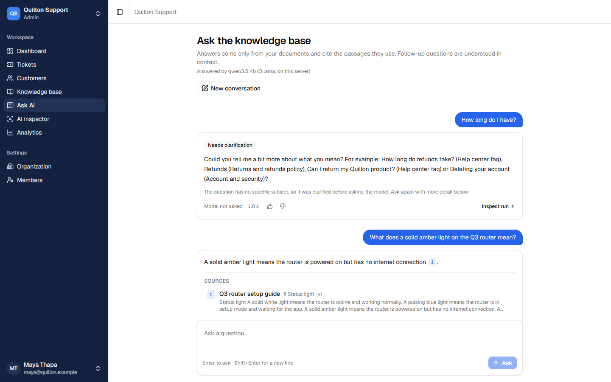
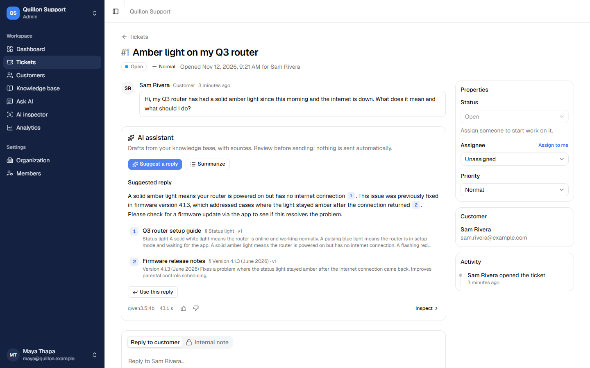
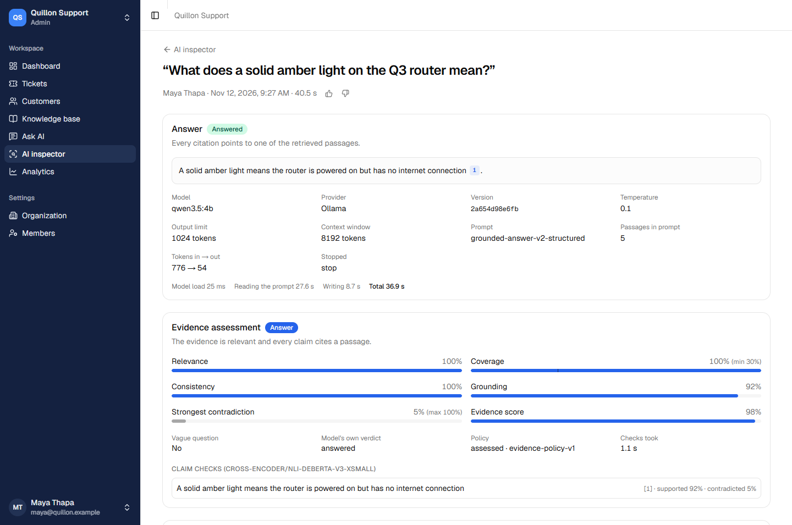
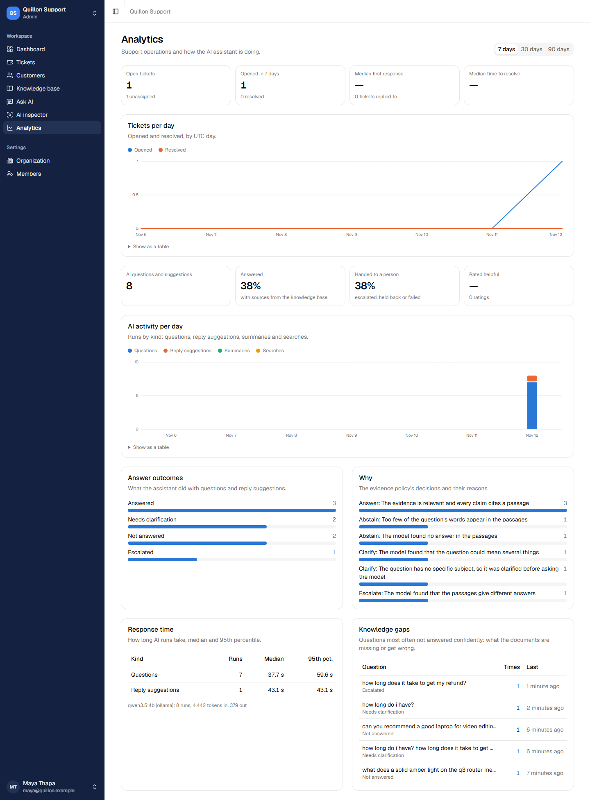
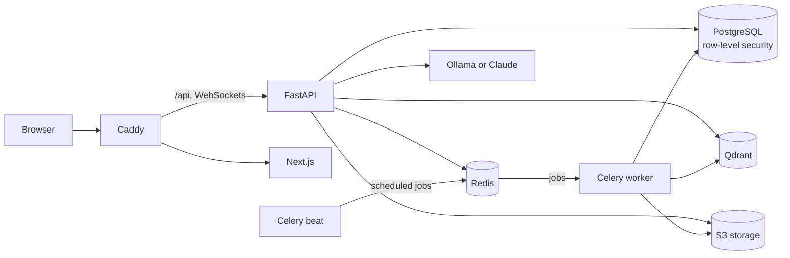

# SupportIQ

**A multi-tenant help desk whose AI assistant answers from your documents, cites its
sources, and knows when not to answer.**

SupportIQ is a customer support platform (organizations, agents, customers, tickets,
a knowledge base) with an AI assistant built around one question: *is the evidence
good enough to answer?* It retrieves passages with hybrid search and reranking, writes
a cited answer, and then decides between **answering**, **asking a clarifying
question**, **escalating** to a person when the documents disagree, and **declining**
when they don't cover the question. Every decision is recorded with its evidence, and
a labelled benchmark measures how well it works.



## Features

- **Help desk.** Organizations with admin, agent and customer roles, email
  invitations, customers, tickets (status, priority, category, assignment, internal
  notes) and live updates over WebSockets. Customers can close their own requests, and
  resolved tickets nobody replies to close automatically after a configurable number of
  days.
- **Knowledge base.** Upload PDF, DOCX, Markdown or text. A background worker extracts
  the text (with OCR for scanned pages, in English and Nepali), splits it into
  sections, embeds it and indexes it. Documents are versioned.
- **Hybrid retrieval.** BM25 in PostgreSQL and dense search in Qdrant, combined with
  weighted Reciprocal Rank Fusion (weights chosen per query type) and reordered by a
  cross-encoder.
- **Cited answers.** A local model through Ollama (`qwen3.5:4b` by default, runs on a
  CPU) or Claude. Citations are checked against the retrieved passages; invented ones
  are removed.
- **Evidence assessment.** Retrieval signals and the model's own structured report
  decide whether to answer, clarify, escalate or decline. Vague questions and
  questions the documents clearly don't cover are settled in about a second, without
  calling the model.
- **AI in tickets.** Suggested replies with sources (an agent always reviews and
  sends), ticket summaries, an "AI escalated" note when the assistant hands a ticket
  to a person, follow-up questions, and helpful/not helpful ratings.
- **AI inspector.** For every run: how the query was classified, each passage's rank
  and score at every stage, the exact prompt, the raw model output and the assessment.
- **Analytics.** Ticket volume and response times; AI outcomes and their reasons,
  latency, ratings, and the questions the assistant couldn't answer.
- **Service levels.** Business hours in the organization's time zone, holidays,
  and first-response and resolution targets per priority, counted in business time.
  Each ticket shows its clocks: time left, due soon, breached, paused while waiting
  for the customer, and a new cycle when it's reopened. A monitor flags deadlines that
  are near or missed, notifies the assignee and the ticket's team leads (admins when
  there's no lead), and analytics report compliance.
- **Teams and agents.** Teams with members and leads, a capacity limit and skills
  (levels 1 to 5) per agent, and each agent's status (available, busy or away) with
  presence that follows their open app. The groundwork for automatic routing.
- **Notifications and audit log.** A live notification bell (assignments, customer
  replies, AI escalations, and replies to customers), optional email per kind, and an
  append-only log of administrative changes.
- **Evaluation.** A labelled benchmark, a command that runs it through the real
  pipeline, and a [report](experiments/reports/quillon-v1-evaluation.md) comparing six
  configurations.

| Ticket with a suggested reply | Evidence assessment in the AI inspector |
| --- | --- |
|  |  |



## Results

From the [evaluation report](experiments/reports/quillon-v1-evaluation.md), on 29
held-out questions over ten support documents, with `qwen3.5:4b` on a laptop CPU:

| | Always answer | With evidence assessment |
| --- | --- | --- |
| Answered a question it should have clarified, escalated or declined | 8 of 13 | **0 of 13** |
| Did what the label expects | 72% (95% CI 54-85%) | **93%** (78-98%) |
| Answerable questions answered correctly | 16 of 16 | 15 of 16 |
| Median response time | 27.7 s | 31.8 s |

Retrieval found the evidence in the top 5 for all 32 answerable questions (MRR@10
0.96 with hybrid search and reranking, 0.89 with BM25 alone). The dataset is small
and synthetic, so read the report's limitations before generalizing from these
numbers.

## Architecture



| Layer | Technology |
| --- | --- |
| Front end | Next.js 16, React 19, TypeScript, TanStack Query, Tailwind CSS, shadcn/ui |
| API | FastAPI, Pydantic, async SQLAlchemy, Alembic |
| Data | PostgreSQL 18 with row-level security, Redis, Qdrant, S3-compatible storage (RustFS) |
| Jobs | Celery (worker and beat scheduler) |
| AI | FastEmbed (bge-small-en-v1.5), ms-marco-MiniLM-L-6-v2 reranker, RapidOCR, Ollama or the Anthropic API |

Tenant isolation is enforced by PostgreSQL row-level security: the API connects as a
role that owns nothing and cannot bypass it. [docs/architecture.md](docs/architecture.md)
describes the components, the question-answering flow, tenancy, live updates and the
data model.

## Quick start (Docker)

You need Docker with Compose 2.24 or later, about 6 GB of free memory, and a model:

- **Local (default):** install [Ollama](https://ollama.com) and run
  `ollama pull qwen3.5:4b` (3.4 GB). Documents never leave your machine; answers take
  20-60 s on a CPU. On Linux, start Ollama with `OLLAMA_HOST=0.0.0.0` so the
  containers can reach it (Docker Desktop on Windows and macOS needs nothing extra).
- **Claude:** create a `.env` file with `LLM_PROVIDER=anthropic` and
  `ANTHROPIC_API_KEY=...`. Faster, billed per question.

Then:

```bash
git clone https://github.com/Tulsee/supportIQ.git
cd supportIQ
docker compose --profile app up -d --build
```

The first build takes several minutes. When it's done, open **http://localhost:8080**:

1. **Create an account**, then an organization. You're its admin.
2. **Knowledge base → Upload document**, and add the files in
   [`datasets/sample_documents/quillon/`](datasets/sample_documents/quillon/): support
   documents for a fictional router and camera company. Each is indexed in a few
   seconds; the first one also downloads the embedding model.
3. **Ask AI** a few questions. Questions in one conversation are read as follow-ups,
   so click **New conversation** between unrelated ones:
   - *What does a solid amber light on the Q3 router mean?* (answered, with a citation)
   - *How long does it take to get my refund?* (escalated: two documents disagree)
   - *How long do I have?* (a clarifying question, without asking the model)
   - *Can you recommend a good laptop for video editing?* (declined)

   The first answer is slower while the model and the reranker load.
4. **Members → Invite** a customer. Emails are caught by Mailpit at
   **http://localhost:8025**. Sign in as the customer in a private window and open a
   ticket, then go back as the admin, open the ticket and click **Suggest a reply**.
5. Open the **AI inspector** and **Analytics** to see what happened.

The services listen on 127.0.0.1 only. API documentation is at
http://localhost:8080/docs. Stop everything with `docker compose --profile app down`
(add `-v` to delete the data as well).

| Port | Service |
| --- | --- |
| 8080 | The application (Caddy: web app and `/api`) |
| 8025 | Mailpit (outgoing email) |
| 5433, 6379, 6433, 9000/9001 | PostgreSQL, Redis, Qdrant, object storage (for development) |

## Development setup

Prerequisites: Python 3.12 with [uv](https://docs.astral.sh/uv/), Node.js 24, Docker
and Ollama.

```bash
docker compose up -d                       # PostgreSQL, Redis, Qdrant, storage, Mailpit

cd backend
uv sync
uv run alembic upgrade head
# API on http://127.0.0.1:8000 (docs at /docs). The timeout keeps a reload from
# waiting forever on the app's open WebSocket connections.
uv run uvicorn app.main:app --reload --timeout-graceful-shutdown 3
uv run celery -A app.workers.celery_app worker --loglevel=info --pool=solo   # second terminal
uv run celery -A app.workers.celery_app beat --loglevel=info   # third terminal: scheduled jobs

cd frontend
npm ci
npm run dev                                # http://localhost:3000
```

Every setting is optional in development and documented in
[`.env.example`](.env.example); copy it to `.env` to change one. The most useful:

| Setting | Default | |
| --- | --- | --- |
| `LLM_PROVIDER` | `ollama` | or `anthropic` (with `ANTHROPIC_API_KEY`) |
| `OLLAMA_MODEL` | `qwen3.5:4b` | any Ollama model |
| `AI_DECISION_POLICY` | `assessed` | `baseline` always answers (the plain RAG baseline) |
| `OCR_SCRIPT` | `devanagari` | Nepali and English; `default` for the bundled Latin/CJK model |
| `EMBEDDING_MODEL` | `BAAI/bge-small-en-v1.5` | any FastEmbed model (needs a re-index) |

### Tests and checks

```bash
cd backend
uv run pytest              # needs the Docker services; uses a separate test database
uv run ruff check . && uv run ruff format --check .

cd frontend
npm run lint && npm run typecheck
npm run gen:api            # after changing the API: regenerates the typed client
```

GitHub Actions runs all of these, applies every migration and checks that it matches
the models, and fails if the generated API types are out of date.

## Evaluation

The benchmark (58 labelled questions over 10 documents, eight categories from
"factual" to "unanswerable") is in [`datasets/`](datasets/README.md). From `backend/`:

```bash
uv run python -m app.cli evaluate --retrieval-only --name retrieval     # seconds
uv run python -m app.cli evaluate --split test --name answers           # ~15 min on a CPU
uv run python -m app.cli compare ../experiments/results/<a>.json ../experiments/results/<b>.json
```

Each question becomes an ordinary run you can open in the AI inspector.
[`experiments/README.md`](experiments/README.md) lists the six experiments and how the
decision thresholds are tuned on the dev split.

## Deploying

The Docker setup runs in development mode for a local demo. For a server:

1. In `.env`, set `APP_ENVIRONMENT=production`, a random `JWT_SECRET_KEY` (64+
   characters), `REFRESH_COOKIE_SECURE=true`, and new `POSTGRES_PASSWORD` and
   `S3_SECRET_ACCESS_KEY` values.
2. Change the API's database password: set `APP_DB_PASSWORD`, and change it in
   PostgreSQL to match (`ALTER ROLE supportiq_app PASSWORD '...'`), since the
   initialization script uses a development password.
3. Set `SITE_ADDRESS` to your domain and `APP_URL` to `https://` plus the domain, and
   publish ports 80 and 443 for the `proxy` service (for example in a
   `docker-compose.override.yml`). Caddy obtains and renews the HTTPS certificate.
4. Point email at a real SMTP server instead of Mailpit (an override for the `api`
   service's `SMTP_*` settings).
5. Choose the model: Claude needs no GPU; a local model needs about 4 GB of memory and
   is slow on a CPU.

Production mode turns off the interactive API docs and refuses to start with the
development JWT secret or insecure cookies.

## Repository layout

```
backend/
  app/            FastAPI app: API routes, services, models, workers, evaluation runner
  ai_engine/      AI pipeline: ingestion, chunking, embeddings, retrieval, reranking,
                  generation, evidence assessment, evaluation metrics
  migrations/     Alembic migrations (schema, grants, row-level security)
  tests/
frontend/         Next.js app (src/app routes, src/components, generated API types)
datasets/         Sample documents and the labelled evaluation questions
experiments/      Evaluation results and reports
infrastructure/   PostgreSQL initialization, Caddy configuration
docs/             Architecture notes and screenshots
```

## Limitations

- With the local model on a CPU, answers take 20-60 seconds.
- Handwriting in scanned documents is detected and flagged, not read.
- Search uses English models; Nepali text is extracted and indexed, but retrieval
  quality in Nepali hasn't been measured.
- The benchmark is small (58 questions) and synthetic; see the report's limitations.
- Single-node deployment; not load-tested.

## Roadmap

Next:
[SLA management and automated ticket routing](docs/features/sla-and-automated-routing.md),
AI ticket triage that abstains when unsure, a customer self-service assistant, and a
knowledge-base contradiction scanner. The full plan is in section 15 of
[IMPLEMENTATION_PLAN.MD](IMPLEMENTATION_PLAN.MD#15-phase-2-feature-roadmap).
