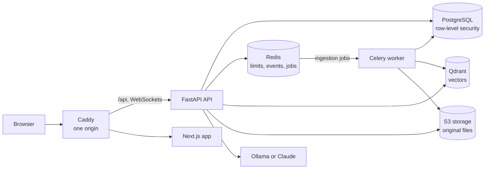
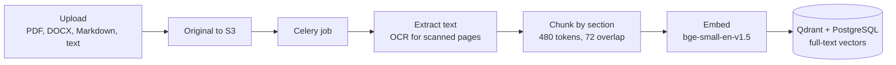
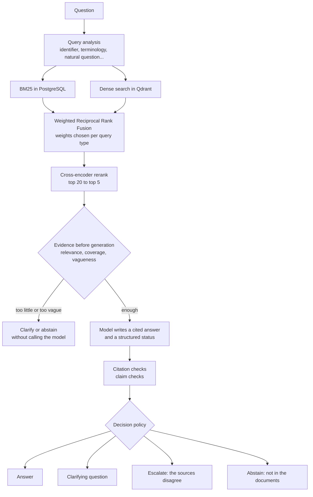

# Architecture

SupportIQ is a modular monolith: one FastAPI application, one background worker and
one Next.js front end, over PostgreSQL, Redis, Qdrant and S3-compatible storage. The
AI pipeline lives in `backend/ai_engine/` as plain Python with no web dependencies,
and the application (`backend/app/`) wires it into requests, jobs and the database.

## Components

| Component | Code | Role |
| --- | --- | --- |
| API | `backend/app/` | REST under `/api/v1`, WebSockets for live ticket updates, answering and search in the request |
| Worker | `backend/app/workers/` | Document ingestion: extraction, OCR, chunking, embedding, indexing |
| AI engine | `backend/ai_engine/` | Ingestion, chunking, embeddings, BM25/dense retrieval and fusion, reranking, prompts, citation checks, evidence signals and the decision policy, evaluation metrics |
| Web app | `frontend/src/` | Next.js App Router, TanStack Query, typed API client generated from the OpenAPI document |
| Proxy | `infrastructure/docker/caddy/` | Serves the app and the API from one origin (Docker setup) |

The browser only ever talks to one origin. In development the Next.js server proxies
`/api` to FastAPI; in the Docker setup Caddy does. That keeps the refresh cookie
same-site and avoids CORS.

## Tenancy and access control

- **Organizations** are the tenants. A user can belong to several, with one role in
  each: admin, agent or customer. The web app sends the active organization in the
  `X-Organization-Id` header, and the API checks membership and role on every request.
- **Row-level security** enforces isolation in PostgreSQL itself. The API connects as
  `supportiq_app`, a role that owns nothing and cannot bypass RLS; migrations run as
  the schema owner and grant it exactly what it needs. At the start of every
  transaction the API sets `app.current_organization_id` and `app.current_user_id`
  (transaction-local, so they can't leak through a pooled connection), and the
  policies read them. Customers see only their own tickets; AI runs, assessments and
  internal notes are staff-only.
- **Authentication:** a short-lived JWT access token kept in browser memory, and a
  refresh token in an httpOnly cookie scoped to `/api/v1/auth`, rotated on every use
  and stored only as a hash. Login and registration are rate-limited per IP and per
  account (Redis).

## Live updates

Ticket changes are published to Redis (one channel per organization) after each
commit and pushed to connected browsers over WebSockets (`/api/v1/ws/tickets`). An
event only says which ticket changed; the browser refetches through the REST API, so
a socket can never reveal more than an API call would.

## Knowledge base ingestion

- Replacing a document's file creates a new **version** (the previous one stays
  searchable until the new one is indexed); citations point to the version they came
  from.
- **OCR** (RapidOCR, PP-OCRv5 Devanagari model) reads scanned PDF pages in Nepali and
  English. Lines below 0.8 confidence are dropped, and pages that are mostly
  unreadable (handwriting, poor scans) are flagged on the document rather than
  indexed as noise.
- A **worker heartbeat** in Redis lets the web app warn when no worker is running.

## Answering a question

- **Retrieval** runs BM25 over PostgreSQL full-text vectors (per-organization
  statistics) and dense search in Qdrant, fuses them with weighted Reciprocal Rank
  Fusion, and reranks the head of the list with ms-marco-MiniLM-L-6-v2. If one
  retriever fails, the run continues with the other and is marked degraded.
- **Generation** uses Ollama (default `qwen3.5:4b`, runs on a CPU) or Claude. The
  prompt gives numbered passages; the model must cite them, and must report whether it
  answered, found nothing, saw a conflict, or needs clarification (JSON schema output).
  Citation numbers that don't match a passage are removed; citations resolve to the
  document, version, page and section.
- **The decision policy** (`ai_engine/evidence/policy.py`) combines the signals into
  one of four decisions. Its thresholds are tuned offline on the dev split of the
  evaluation set (`app.cli tune-policy`), and a `baseline` mode (always answer) and an
  `observe` mode (decide but always generate) exist for experiments.
- **Every run is recorded**: the query analysis, each candidate's rank and score at
  every stage, the exact prompt, the raw model output, the citations, the assessment
  (signals, thresholds, decision and reason) and timings. The AI inspector shows all
  of it, and each run also writes one structured log line.

## AI in tickets

Reply suggestions run the same pipeline on the ticket's subject and latest customer
message (plus the message before it when the latest is a short follow-up), and are
written to the customer, with sources.
Nothing is sent automatically: an agent reviews, edits and sends. When the policy
escalates or abstains, an "AI escalated" event is added to the ticket's activity
(staff only). Summaries condense the thread for a person picking the ticket up. Any AI
run can be rated helpful or not helpful, and the analytics page aggregates ratings,
decisions, latency and the questions the assistant couldn't answer.

## Data model

The main tables, all scoped to an organization:

| Area | Tables |
| --- | --- |
| Accounts | `users`, `organizations`, `organization_members`, `organization_invitations`, `refresh_tokens` |
| Support | `customers`, `tickets`, `ticket_messages`, `ticket_events`, `ticket_counters` |
| Knowledge base | `documents`, `document_chunks` (text, metadata, full-text vector; embeddings in Qdrant) |
| AI | `ai_runs`, `retrieval_results`, `ai_answers`, `citations`, `evidence_assessments`, `ai_feedback` |

Enumerations are stored as text with CHECK constraints, and every schema change is an
Alembic migration (`backend/migrations/`). CI applies all migrations, checks they match
the models, and runs them down and up again.

## API

- REST under `/api/v1`, documented by FastAPI's OpenAPI schema: interactive docs at
  `/docs` outside production, and the schema at `/api/v1/openapi.json`.
- The front end's types are generated from that schema (`npm run gen:api` writes
  `frontend/src/lib/api/schema.d.ts`), and CI fails if they drift from the backend.
- Errors use one shape (`{"error": {"code", "message", ...}}`) with stable codes.

## Evaluation

`backend/app/evaluation/` runs the labelled benchmark in `datasets/` through the real
pipeline, as ordinary recorded runs, and writes Markdown and JSON reports to
`experiments/results/`. See [`experiments/README.md`](../experiments/README.md) and
the [evaluation report](../experiments/reports/quillon-v1-evaluation.md).
