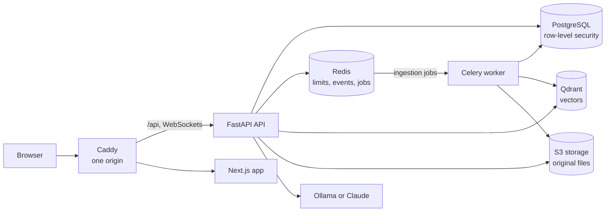
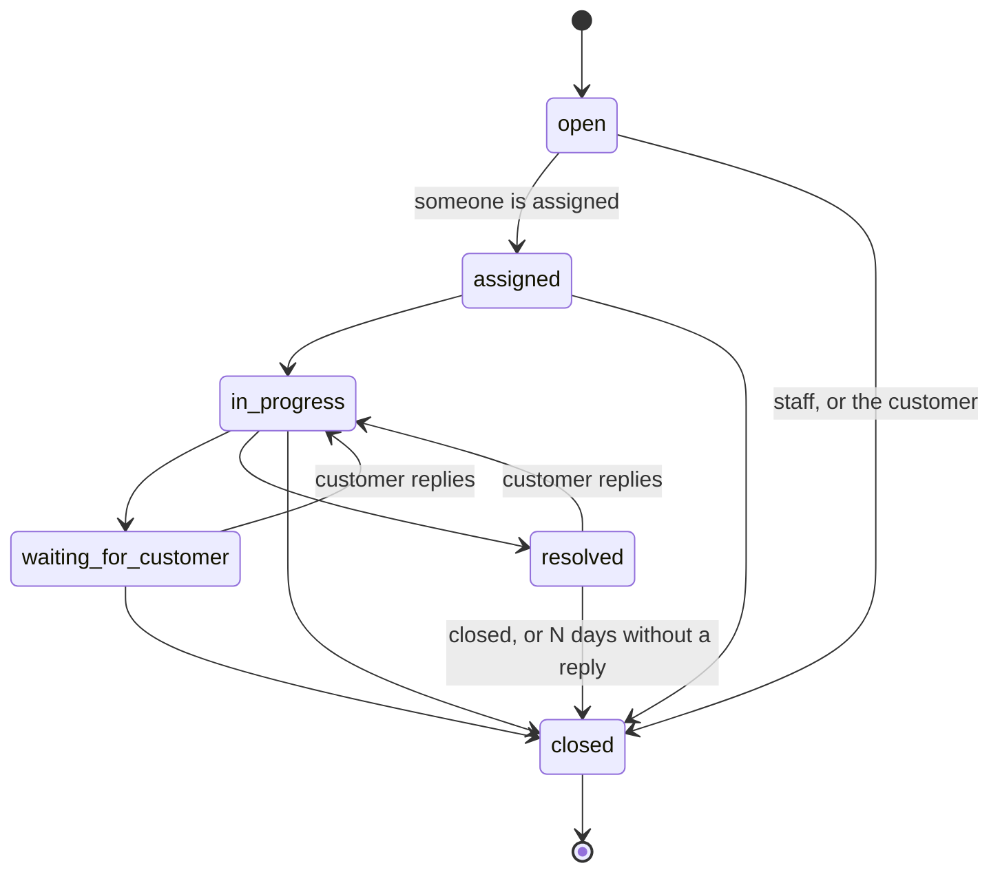
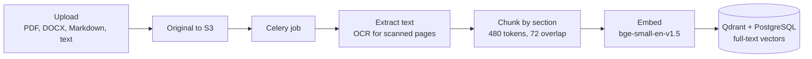
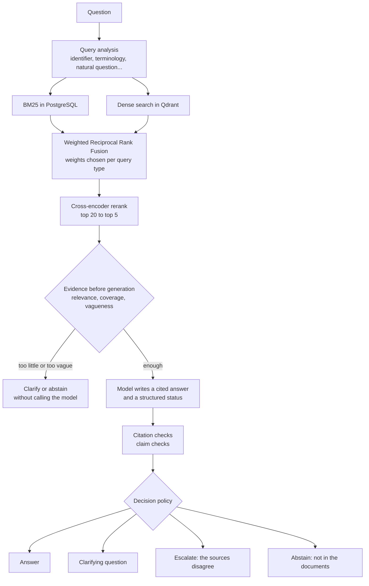

# Architecture

SupportIQ is a modular monolith: one FastAPI application, one background worker and
one Next.js front end, over PostgreSQL, Redis, Qdrant and S3-compatible storage. The
AI pipeline lives in `backend/ai_engine/` as plain Python with no web dependencies,
and the application (`backend/app/`) wires it into requests, jobs and the database.

## Components

| Component | Code | Role |
| --- | --- | --- |
| API | `backend/app/` | REST under `/api/v1`, WebSockets for live ticket updates, answering and search in the request |
| Worker | `backend/app/workers/` | Document ingestion, notification emails, and scheduled jobs |
| Scheduler | `backend/app/workers/celery_app.py` | Celery beat: puts periodic jobs on the queue (auto-closing resolved tickets; SLA checks next). Run exactly one |
| AI engine | `backend/ai_engine/` | Ingestion, chunking, embeddings, BM25/dense retrieval and fusion, reranking, prompts, citation checks, evidence signals and the decision policy, evaluation metrics |
| Web app | `frontend/src/` | Next.js App Router, TanStack Query, typed API client generated from the OpenAPI document |
| Proxy | `infrastructure/docker/caddy/` | Serves the app and the API from one origin (Docker setup) |

The browser only ever talks to one origin. In development the Next.js server proxies
`/api` to FastAPI; in the Docker setup Caddy does. That keeps the refresh cookie
same-site and avoids CORS.

## Tenancy and access control

- **Organizations** are the tenants. A user can belong to several, with one role in
  each: admin, agent or customer. The web app sends the active organization in the
  `X-Organization-Id` header, and the API checks membership and role on every request.
- **Row-level security** enforces isolation in PostgreSQL itself. The API connects as
  `supportiq_app`, a role that owns nothing and cannot bypass RLS; migrations run as
  the schema owner and grant it exactly what it needs. At the start of every
  transaction the API sets `app.current_organization_id` and `app.current_user_id`
  (transaction-local, so they can't leak through a pooled connection), and the
  policies read them. Customers see only their own tickets; AI runs, assessments and
  internal notes are staff-only.
- **Authentication:** a short-lived JWT access token kept in browser memory, and a
  refresh token in an httpOnly cookie scoped to `/api/v1/auth`, rotated on every use
  and stored only as a hash. Login and registration are rate-limited per IP and per
  account (Redis).

## Live updates

Ticket changes are published to Redis (one channel per organization) after each
commit and pushed to connected browsers over WebSockets (`/api/v1/ws/tickets`). An
event only says which ticket changed; the browser refetches through the REST API, so
a socket can never reveal more than an API call would.

## Ticket lifecycle and scheduled jobs

- Closing is final: closed tickets take no replies and can't be reopened. Staff can
  close any open ticket; customers can close their own requests.
- **Auto-close:** the scheduler runs `tickets.auto_close` every
  `AUTO_CLOSE_INTERVAL_MINUTES` (30). It closes resolved tickets nobody has replied to
  for the organization's `auto_close_after_days` (Settings → Organization, default 7,
  0 = off), across organizations under the RLS bypass, in batches with
  `FOR UPDATE SKIP LOCKED`, so two schedulers never close a ticket twice. The timeline
  records it as an automatic change. `python -m app.cli auto-close` runs it on demand.
- **Categories** are defined per organization (Settings → Categories), set by staff,
  invisible to customers (RLS), and deactivated rather than deleted. Routing rules
  (Module 10) will match on them.

## Service levels

- `app/domain/business_time.py` is a pure calculator: deadlines, warning times and
  durations in business minutes for a calendar (IANA time zone, intervals per weekday,
  holidays). Interval boundaries are converted to real instants, so daylight-saving
  changes count the time that actually elapsed. It is tested with Kathmandu's
  UTC+05:45 offset, London's clock changes, holidays, breaks and interval edges.
- Each organization has one business calendar (`business_calendars`, `business_hours`,
  `business_holidays`) and SLA policies per priority, with an optional default
  (`sla_policies`, versioned when a target changes). All staff-only under RLS; admins
  edit them under Settings → Service levels, starting from a one-click default setup.
  `GET /sla/preview` shows when a ticket of a priority would be due.
- **Clocks** (`ticket_sla_clocks`, `ticket_sla_pauses`, `app/services/sla_clocks.py`):
  a new ticket gets a first-response and a resolution clock from its priority's
  policy. The deadline is `started_at` plus `target + paused` business minutes in a
  snapshot of the calendar taken when the clock started, so edits to hours or targets
  never move running clocks. The first public staff reply after the opening message
  meets the first response; resolving meets the resolution clock; waiting for the
  customer pauses it; reopening starts a new cycle; a priority change re-targets
  unmet clocks; closing cancels them. Customers' actions move clocks too, so the
  hooks run as a system operation under the RLS bypass. The state people see (on
  track, due soon, breached, paused, met, met late, cancelled) is derived on read
  (`app/domain/sla.py`).
- **The monitor** (`app/services/sla_monitor.py`, scheduled every
  `SLA_MONITOR_INTERVAL_SECONDS`, also `python -m app.cli sla-check`) claims running
  clocks past their warning time or deadline (`FOR UPDATE SKIP LOCKED`), records the
  transition once (at the warning time or deadline itself), adds a staff-only ticket
  event and notifies: due soon to the assignee (or, if unassigned, the escalation
  contacts), breaches to both, by email by default. Escalation contacts are the leads
  of the ticket's team, or the admins when it has no active team or the team has no
  lead. Analytics report compliance for clocks
  started in the period: met on time / (on time + late + overdue), with clocks still in
  time, cancelled ones and reopened cycles reported separately.

## Teams and agents

Module 10, phase 5 (`app/services/teams.py`, `app/websocket/presence.py`), the
groundwork for routing:

- **Teams** (`teams`, `team_members` with role `member` or `lead`), managed by admins
  and audited; deactivated rather than deleted. A ticket can belong to one team
  (`tickets.team_id`, staff-only, a `team_changed` timeline event).
- **Agents**: per staff member and organization, `agent_profiles` (status
  `available`, `busy` or `away`; `max_active_tickets`, default 10) and `agent_skills`
  (slug and level 1-5). Workload counts tickets assigned to them that are `assigned`
  or `in_progress`; waiting for the customer doesn't count. `GET /agents` shows it all.
- **Presence**: a staff member's open WebSocket marks them seen when it's ready and
  every 30 seconds, in one Redis sorted set per organization; seen in the last 90
  seconds = online. Effective presence is their status while online, otherwise
  `offline`. If Redis is down nobody is online (routing will then leave tickets
  unassigned rather than guess).
- Leaving the organization, or moving to the customer role, removes someone's team
  memberships, skills and profile. All four tables are staff-only under RLS.

## Automatic routing

Module 10, phase 6. Pure logic in `app/domain/routing.py` (conditions, rule order,
eligibility, the three strategies, explanations); `app/services/routing.py` applies it:

- **Rules** (`routing_rules`, admin-managed, audited): constrained conditions (`all` /
  `any` of `{field, operator, value}` on category, priority, subject or customer
  metadata), a team, a strategy (`least_loaded`, `round_robin`, `skill_match`,
  `manual`) and required skills. The first active match wins.
- **Running it**: when a ticket is opened unassigned, the API queues
  `routing.route_ticket` after the commit (if the organization's `routing_mode` is
  `on` or `shadow`); `routing.sweep` (every minute) catches tickets whose job never
  ran; staff can **reroute** an unassigned ticket at any time. Each run locks the
  ticket and stops if someone was assigned meanwhile or it was already routed, so a
  person's choice always wins and nothing is routed twice. The chosen agent's profile
  row is locked and their workload counted again before assigning, so concurrent runs
  can't push anyone past capacity.
- **Decisions** (`routing_decisions`): every run's rules tried, ranked candidates with
  the reasons others were skipped, the outcome (`assigned`, `team_only`, `no_agent`,
  `no_rule`) and a readable explanation. `no_agent` notifies the team's leads (or the
  admins). In `shadow` mode decisions are recorded but not applied. A simulator shows
  what would happen, without writing.
- **Measured** (`GET /analytics/routing`): outcomes, the share of first assignments
  made by routing and the time to them, automatic assignments people changed within an
  hour, agreement with shadow decisions, and workload per agent. Concurrency is tested
  with real transactions (`tests/test_routing_load.py`): a burst of runs fills every
  agent exactly to capacity, and two sweeps or two SLA monitors at once each act once
  per ticket or clock.

## AI ticket triage

Module 11 (`ai_engine/triage/`, `app/services/triage.py`, [feature doc](features/ai-triage.md)).
A new ticket without a category goes to a triage job before routing: the language model
picks one of the organization's category keys or "unsure" (JSON-schema output), similar
tickets a person labelled vote with their embeddings, and the combined score decides
whether the category is applied (mode `on`) or only suggested. Priority is only
suggested; the language is stored and routing can use it. People's category choices
become labels and record whether the prediction was right; analytics report coverage
and accuracy, and the triage set's T1-T4 experiments tune α and the threshold.

## Notifications and audit log

- **Notifications** (`notifications`) are readable only by their recipient. Writing one
  for someone else (the assignee hears about a customer reply) is a small, explicit
  system operation under the RLS bypass. A `dedupe_key` per recipient makes delivery
  idempotent. Rows are written in the transaction that makes the change; after the
  commit, the recipient's open app gets a `notification.created` ping on the same
  WebSocket (only that user receives it), and a Celery task sends any emails, with
  retries. Each person chooses per kind: off, in the app, or in the app and by email.
- **The audit log** (`audit_log`) records administrative changes (organization name,
  member roles and removals, invitations, document deletions) with the actor and a
  minimal before/after, in the same transaction as the change. The API role has no
  UPDATE or DELETE privilege on it, so entries can't be altered even by a bug in the
  application. Admins read it under Settings.

## Knowledge base ingestion

- Replacing a document's file creates a new **version** (the previous one stays
  searchable until the new one is indexed); citations point to the version they came
  from.
- **OCR** (RapidOCR, PP-OCRv5 Devanagari model) reads scanned PDF pages in Nepali and
  English. Lines below 0.8 confidence are dropped, and pages that are mostly
  unreadable (handwriting, poor scans) are flagged on the document rather than
  indexed as noise.
- A **worker heartbeat** in Redis lets the web app warn when no worker is running.

## Answering a question

- **Retrieval** runs BM25 over PostgreSQL full-text vectors (per-organization
  statistics) and dense search in Qdrant, fuses them with weighted Reciprocal Rank
  Fusion, and reranks the head of the list with ms-marco-MiniLM-L-6-v2. If one
  retriever fails, the run continues with the other and is marked degraded.
- **Generation** uses Ollama (default `qwen3.5:4b`, runs on a CPU) or Claude. The
  prompt gives numbered passages; the model must cite them, and must report whether it
  answered, found nothing, saw a conflict, or needs clarification (JSON schema output).
  Citation numbers that don't match a passage are removed; citations resolve to the
  document, version, page and section.
- **The decision policy** (`ai_engine/evidence/policy.py`) combines the signals into
  one of four decisions. Its thresholds are tuned offline on the dev split of the
  evaluation set (`app.cli tune-policy`), and a `baseline` mode (always answer) and an
  `observe` mode (decide but always generate) exist for experiments.
- **Every run is recorded**: the query analysis, each candidate's rank and score at
  every stage, the exact prompt, the raw model output, the citations, the assessment
  (signals, thresholds, decision and reason) and timings. The AI inspector shows all
  of it, and each run also writes one structured log line.

## AI in tickets

Reply suggestions run the same pipeline on the ticket's subject and latest customer
message (plus the message before it when the latest is a short follow-up), and are
written to the customer, with sources.
Nothing is sent automatically: an agent reviews, edits and sends. When the policy
escalates or abstains, an "AI escalated" event is added to the ticket's activity
(staff only). Summaries condense the thread for a person picking the ticket up. Any AI
run can be rated helpful or not helpful, and the analytics page aggregates ratings,
decisions, latency and the questions the assistant couldn't answer.

## Data model

The main tables, all scoped to an organization:

| Area | Tables |
| --- | --- |
| Accounts | `users`, `organizations`, `organization_members`, `organization_invitations`, `refresh_tokens` |
| Support | `customers`, `tickets`, `ticket_messages`, `ticket_events`, `ticket_counters`, `ticket_categories` |
| Knowledge base | `documents`, `document_chunks` (text, metadata, full-text vector; embeddings in Qdrant) |
| AI | `ai_runs`, `retrieval_results`, `ai_answers`, `citations`, `evidence_assessments`, `ai_feedback` |
| Notifications and audit | `notifications`, `notification_preferences`, `audit_log` |
| Service levels | `business_calendars`, `business_hours`, `business_holidays`, `sla_policies`, `ticket_sla_clocks`, `ticket_sla_pauses` |

Enumerations are stored as text with CHECK constraints, and every schema change is an
Alembic migration (`backend/migrations/`). CI applies all migrations, checks they match
the models, and runs them down and up again.

## API

- REST under `/api/v1`, documented by FastAPI's OpenAPI schema: interactive docs at
  `/docs` outside production, and the schema at `/api/v1/openapi.json`.
- The front end's types are generated from that schema (`npm run gen:api` writes
  `frontend/src/lib/api/schema.d.ts`), and CI fails if they drift from the backend.
- Errors use one shape (`{"error": {"code", "message", ...}}`) with stable codes.

## Evaluation

`backend/app/evaluation/` runs the labelled benchmark in `datasets/` through the real
pipeline, as ordinary recorded runs, and writes Markdown and JSON reports to
`experiments/results/`. See [`experiments/README.md`](../experiments/README.md) and
the [evaluation report](../experiments/reports/quillon-v1-evaluation.md).
