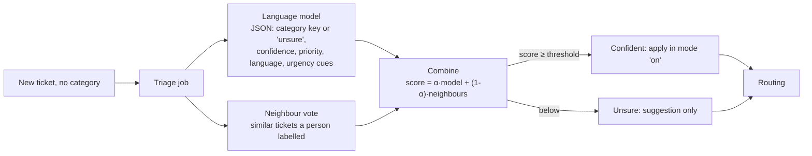

# AI ticket triage

**Status:** implemented (Module 11 in the [implementation plan](../../IMPLEMENTATION_PLAN.MD#155-module-11---ai-ticket-triage-with-abstention), 12 November 2026).

When a ticket is opened without a category, SupportIQ suggests what it's about, how
urgent it is and what language it's written in, and **abstains** when it isn't sure:
the category stays empty for a person, and the best guess is only a suggestion. It's
the same idea as the answer assistant's evidence policy (Module 5), applied to
classification. Triage feeds routing (rules on category and language), and can run
silently first (shadow mode) to measure its accuracy before it changes anything.

## How a prediction is made

1. **The language model** (`ai_engine/triage/llm.py`) gets the organization's
   categories (key, name, description) and the ticket's subject and opening message,
   fenced as data, and must answer with JSON matching a schema whose category is one of
   the organization's keys or `unsure` (Ollama's grammar-constrained output, or
   Claude's structured output). Its self-reported confidence (`low`, `medium`, `high`)
   becomes 0.35, 0.65 or 0.9. It also suggests a priority, detects the language (ISO
   639-1) and quotes up to five urgency cues.
2. **The neighbour vote** (`ai_engine/triage/neighbours.py`): the ticket's text is
   embedded (the knowledge base's bge-small model) and compared with **labels**,
   tickets whose category a person set or confirmed. The 10 most similar at or above
   0.5 cosine similarity vote, weighted by similarity; fewer than two close enough
   means no signal.
3. **Combining** (`ai_engine/triage/combine.py`): `score(c) = α·model(c) +
   (1-α)·share(c)`, where `model(c)` is the model's confidence for the category it
   picked; with one signal missing, the other's score is used. The top category is
   **confident** at or above the threshold. α and the threshold are tuned on the triage
   set's dev split (below) and set in `TRIAGE_ALPHA` / `TRIAGE_THRESHOLD` (0.3 and
   0.425). For a ticket in a language the embedding model can't read
   (`TRIAGE_NEIGHBOUR_LANGUAGES`, English by default) the neighbour vote is skipped
   and the model decides alone.

## What happens with it

| Triage mode (Settings → Categories) | Confident | Unsure | Shown to staff |
| --- | --- | --- | --- |
| `off` (default) | — | — | — |
| `shadow` | recorded only | recorded only | nothing (so the guess can't sway the person it's measured against) |
| `on` | category applied (an automatic timeline event: "AI triage, 92% sure"), language stored | suggestion | the AI triage panel |

Priority is **never** applied: the panel offers "Use it" when the suggestion differs.
A ticket whose category a person chose when opening it isn't triaged. Triage runs as a
Celery job queued after the ticket is committed, and **routing runs right after it in
the same job**, so rules see the category (and language: routing gained a `language`
field). If triage fails, the ticket is routed anyway; the routing sweep still catches
tickets whose job never ran. Nothing is locked while the model thinks (tens of seconds
on a laptop): the job reads its inputs, calls the model outside any transaction, then
locks the ticket and checks again; if a person chose a category meanwhile, theirs
stands and nothing is recorded.

**Learning from people.** When a person sets, changes, clears or accepts a category,
the ticket becomes (or stops being) a label for the neighbour vote, and its prediction
records the outcome once: `confirmed`, `changed` or `cleared`. Categories the AI
applied are never labels unless a person confirms them, so the vote can't learn from
its own mistakes. Label embeddings are computed by the triage job (up to 200 per run)
and stored in Postgres (`real[]`); the vote compares against the organization's 2,000
most recent labels in memory.

**Measured in use** (`GET /analytics/triage`, Analytics → AI triage): coverage (share
confident), accuracy of confident predictions people reviewed, accuracy of the top guess
when triage abstained (what abstaining avoided), per category, and latency. In shadow
mode the same numbers compare guesses with what people chose.

## Data and API

| Table | Contents |
| --- | --- |
| `ticket_triage` | One per ticket: mode, decision (`confident`, `unsure`, `failed`), applied, top guess (id, key and name copied), combined score, threshold and α used, agreement, suggested priority, language, urgency cues, both signals (`signals` JSONB: the model's vote; neighbour shares and the similar tickets), model, latency, error; and the review (outcome, final category, who, when). |
| `triage_labels` | Ticket, category key, embedding and its model. |
| `tickets.language` | ISO 639-1, set by triage in mode `on`. |

Both tables are staff-only under RLS. `GET /tickets/{id}/triage` (staff),
`POST /tickets/{id}/triage/accept` (staff: sets the suggested category or confirms the
applied one), `PATCH /organizations/{id}` with `settings.triage_mode`.

## Deviations from the plan

| Plan | Here | Why |
| --- | --- | --- |
| Apply when the signals agree *or* the combined confidence clears a threshold | Only the combined score decides; agreement raises it | One tuned rule instead of two; agreement with weak signals shouldn't bypass the threshold |
| Routing reports `manual_review` when no category is applied | Routing runs on whatever is set; uncategorized tickets match category-free rules or stay `no_rule` | The routing outcomes already say why a ticket wasn't assigned |
| Embeddings in the vector store | `real[]` in Postgres, compared in memory (bounded) | Labels stay under RLS and transactional with the category change; Qdrant or pgvector is the path beyond a few thousand labels |

## Evaluation (experiments T1-T4)

The [triage set](../../datasets/README.md#triage-set) has 154 synthetic Quillon tickets
(7 categories, 77 dev and 77 test, 14 deliberately ambiguous, 6 in Nepali, 2 prompt
injections). `uv run python -m app.cli evaluate-triage --name t1-t4` runs:

| | Configuration |
| --- | --- |
| T1 | The language model alone (abstains only by answering "unsure") |
| T2 | The neighbour vote alone (labels: the dev split; dev tickets leave themselves out) |
| T3 | Combined, always applying the top category |
| T4 | Combined with abstention: α and threshold tuned on dev for the most coverage at ≥ 95% accuracy |
| T5 | T4 with the neighbour vote only for languages the embedder reads (added after the error analysis) |

Results ([report](../../experiments/reports/triage-t1-t4.md), test split, qwen3.5:4b):
the model alone is 97.4% accurate but reports "high" confidence on almost every ticket,
right or wrong, so it can't say when to abstain; combined with the neighbours, the
score ranks mistakes last, and T4 (α 0.3, threshold 0.425) applied 85.7% of tickets at
98.5% accuracy. A fifth configuration added after the error analysis, T5, skips the
neighbour vote for languages the English-only embedder can't read (the Nepali tickets):
90.9% coverage at 98.6%. Production uses T5's settings. The combined score isn't a
probability, so the app shows it as a score next to the threshold. Priority suggestions
were within one level every time; language detection was always right.
