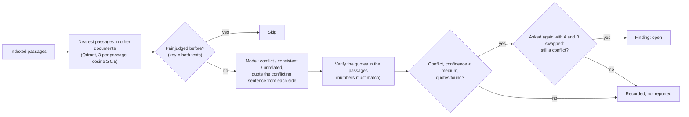

# Knowledge-base contradiction scanner

**Status:** implemented (Module 13, first part, in the
[implementation plan](../../IMPLEMENTATION_PLAN.MD#157-module-13---knowledge-base-quality-loop),
17 November 2026). Evaluated in the [C1-C3 report](../../experiments/reports/contradictions-c1-c3.md).
The second part, [knowledge gaps to articles](knowledge-gaps.md), reuses the judge to
check drafts against the knowledge base. Document owners with review dates (the third
part) aren't built yet.

In the [answer evaluation](../../experiments/reports/quillon-v1-evaluation.md), documents
that contradict each other were the most common reason for an escalation: the assistant
correctly refuses to pick a side, but every question that touches the conflict goes to a
person until someone fixes the documents. The scanner finds those conflicts before
customers do, and shows an admin both passages with the conflicting sentences marked.

## How a scan works

1. **Resolve stale findings.** An open finding whose passage was replaced (its document
   was re-indexed or a new version uploaded) is resolved automatically
   (`document_changed`). The finding keeps a copy of both passages, so it still shows
   what conflicted.
2. **Candidate pairs** (`ai_engine/contradictions/candidates.py`). Two passages can only
   contradict each other if they're about the same thing, so each passage of at least
   15 tokens is paired with its 3 nearest passages *in other documents* at cosine
   similarity 0.5 or more, using the vectors already in Qdrant (no new embeddings).
   On the Quillon knowledge base that is 97 of the 902 cross-document pairs, and all
   six planted conflicts are among them (C1).
3. **Only new text.** Each pair is identified by a hash of its two texts. A pair is sent
   to the model once, and again only if one of the passages changes. Failed judgements
   are retried by the next scan. A scan judges at most 40 pairs, most similar first; the
   rest wait for the next scan.
4. **The judge** (`ai_engine/contradictions/judge.py`). One model call per pair, with
   JSON output constrained to a schema: a verdict (`conflict`, `consistent` or
   `unrelated`), a confidence, and for a conflict up to three items, each with the
   conflicting sentence copied from passage A and from passage B and a one-sentence
   explanation. Both passages are fenced as data. The prompt spells out what is *not* a
   conflict: different products or plans, more detail on one side, rewording.
5. **Verification.** Each quoted sentence must be found in its own passage: exactly
   after normalizing case, spacing and punctuation, or nearly (90% of the characters in
   runs of 4 or more), and **every number in the quote must appear in the passage**. A
   model that misquotes "30 days" as "90 days" could otherwise invent a conflict. Swapped
   sides are corrected rather than penalized.
6. **Decision** (`ScanPolicy`). A pair is a finding when the verdict is `conflict`, the
   confidence is at least `medium`, and at least one conflict's quotes were found on
   both sides, **and** the model says so again when asked with the passages swapped
   (`CONTRADICTION_BOTH_ORDERS`; only flagged pairs are asked twice). Small models are
   swayed by which passage comes first: in the evaluation the second question removed
   half the false alarms and no real conflict, for 13% more calls.

Every judged pair is stored (`contradiction_checks`), not just findings, with the
model's replies and the policy that decided, so a decision can be audited and the
evaluation can re-score it.

## Running scans

- **On demand:** an admin presses **Scan now** on Knowledge base → Contradictions. The
  scan runs in a worker; the page follows it and lists new findings when it finishes.
  Only one scan runs per organization at a time (a partial unique index on running
  scans), so a second request gets `409 scan_running`.
- **On a schedule:** with **Scan automatically** on (the organization setting
  `contradiction_scan`), the scheduler checks every 15 minutes and starts a scan when
  the last one is older than `CONTRADICTION_SCAN_INTERVAL_MINUTES` (6 hours), or when
  it stopped at the per-scan limit with pairs left over. A first pass over a large
  knowledge base therefore runs in 40-pair scans one after another, and later scans
  only judge passages that are new or changed.

With the local model on a laptop CPU a call takes about 20 seconds, so the first pass
over a knowledge base this size (97 pairs, 110 calls) takes about 35 minutes of model
time, in three scans. The per-scan limit keeps one scan from occupying the model for hours while
people are asking it questions.

## Reviewing findings

Each finding shows the two passages side by side with the conflicting sentences
highlighted, the explanation, the model's confidence, and links to both documents.
Admins can:

- **Resolve** it: the documents were fixed. Usually this happens by itself, because
  uploading the corrected document resolves the finding (`document_changed`).
- **Dismiss** it: not a real conflict, or an acceptable one. It isn't reported again
  unless one of the passages changes.
- **Reopen** it.

Reviews are recorded in the audit log (entity `contradiction`). Agents can see findings
but can't scan or review; customers can't see them (RLS).

## Settings

| Variable | Default | Meaning |
| --- | --- | --- |
| `CONTRADICTION_NEIGHBOURS` | 3 | Nearest passages in other documents per passage |
| `CONTRADICTION_MIN_SIMILARITY` | 0.5 | Cosine similarity floor for a candidate pair |
| `CONTRADICTION_MIN_TOKENS` | 15 | Shorter passages (a title on its own) are skipped |
| `CONTRADICTION_MAX_PAIRS_PER_SCAN` | 40 | Pairs sent to the model per scan |
| `CONTRADICTION_MIN_CONFIDENCE` | 0.65 | The model's confidence must reach this (medium) |
| `CONTRADICTION_REQUIRE_GROUNDING` | true | Both quotes must be found in their passages |
| `CONTRADICTION_BOTH_ORDERS` | true | Ask flagged pairs again with the passages swapped; both must agree |
| `CONTRADICTION_SCAN_INTERVAL_MINUTES` | 360 | Scheduled scans (organizations with scanning on); 0 turns the schedule off |

## API

All under `/api/v1/knowledge/contradictions`, in the organization in `X-Organization-Id`.

| Method and path | Who | What |
| --- | --- | --- |
| `GET /summary` | staff | Open, resolved and dismissed counts, pairs checked, the latest scan, whether scheduled scans are on |
| `POST /scans` | admin | Start a scan (`202`; `409 scan_running`; `503` if the job queue is down) |
| `GET /` | staff | Findings, newest first; filter by `status` and `document_id` |
| `GET /{id}` | staff | One finding |
| `PATCH /{id}` | admin | `{"status": "dismissed" \| "resolved" \| "open", "note": "..."}` |

## Evaluation

`uv run python -m app.cli evaluate-contradictions --name c1-c3` (from `backend/`) indexes
the Quillon documents into the evaluation organization, builds the candidate pairs, asks
the model about every pair in both orders (replies are cached, so the run can resume),
and scores five decision policies on the same replies. The gold labels are the evidence
quotes of the dataset's six `conflicting` questions. From the
[C1-C3 report](../../experiments/reports/contradictions-c1-c3.md), with `qwen3.5:4b`:

| | Default policy |
| --- | --- |
| Planted contradictions found | **6 of 6** (95% CI 61-100%), each quoting the planted sentences |
| Flagged pairs | 10, of which 6 planted (60%, CI 31-83%) and 7 real when checked by hand (70%, CI 40-89%) |
| Pairs sent to the model | 97 of 902 cross-document pairs; 110 calls, about 35 minutes on a laptop CPU |

The remaining false alarms are mostly release notes ("fixes a problem where the light
stayed amber") read as contradicting the behaviour they fixed. The quote check and the
confidence floor didn't remove anything in this run: the model quoted correctly and
always reported high confidence.

## Limitations

- **Pairs, not groups.** A conflict spread over three documents shows up as two or three
  pairwise findings.
- **The neighbour search can miss a conflict.** The planted pair about Secure Plus cloud
  video history has a similarity of only 0.63; a floor of 0.7 would miss it. Conflicts
  between passages that are about the same fact but worded very differently need more
  neighbours or a lower floor, which costs model calls.
- **One passage per chunk.** A chunk that covers several topics is compared as a whole;
  the quotes say which sentences conflict.
- **Six positives.** The evaluation's recall estimate rests on six planted conflicts, so
  its confidence interval is wide. See the report.
