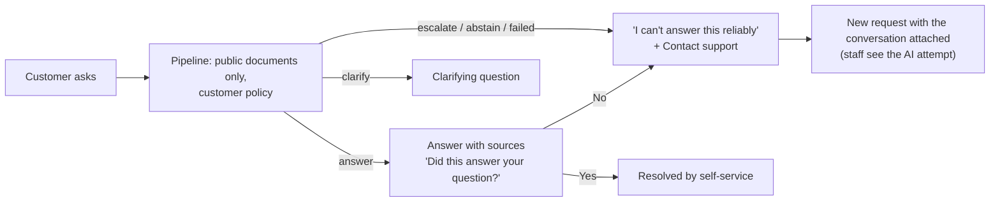

# Customer self-service assistant

**Status:** phases 1-4 and the analytics of phase 5 implemented (Module 12 in the
[implementation plan](../../IMPLEMENTATION_PLAN.MD#156-module-12---customer-self-service-assistant),
13 November 2026). The S1-S3 evaluation is next.

Customers can ask the assistant themselves, in the portal, before opening a request.
It is the staff assistant's pipeline (retrieval, structured answer, evidence policy,
citations) with three differences: it reads only documents an admin has made
**public**, it is **stricter** (anything short of a complete, cited, supported answer
becomes "I can't answer this reliably"), and every dead end offers **Contact
support**, which opens a request with the conversation attached so staff see what
the assistant tried.

## What the customer sees

| Pipeline outcome | Shown to the customer |
| --- | --- |
| `answered` | The answer, with sources (document title, page, section), and "Did this answer your question?" |
| `clarify` | The clarifying question |
| `escalated` (sources disagree) | "I can't answer this reliably", Contact support. The conflicting statements are **not** shown: a customer can't tell which is current. |
| `abstained`, `declined`, `no_passages`, `uncited`, `failed` | Same, Contact support |

A partial answer abstains for customers (`abstain_on_partial` is forced on, whatever
the staff policy's tuned value), and the `observe` and `baseline` policies never apply
to customers. Follow-ups use the conversation's last three turns, read **from the
database**: a client can't supply a fake assistant turn.

## Public documents, enforced by the database

`documents.visibility` is `internal` (the default, and every existing document) or
`public`; admins change it on the knowledge base page (`PATCH /documents/{id}`,
audit-logged). The boundary is held twice:

1. **Row-level security.** New permissive `SELECT` policies let a customer member read
   `documents` rows that are public and `document_chunks` rows of public documents.
   Staff policies are unchanged. A customer request therefore can't load internal text
   even through an unfiltered query: BM25 runs under the customer's RLS context (its
   corpus statistics cover public chunks only, so scores reveal nothing about internal
   ones), and reranking and prompts load chunks through the same context.
2. **The retrieval filter.** `RetrievalService.search(public_only=True)` restricts BM25
   and chunk loading explicitly, and the dense search sends Qdrant a filter on the
   public document ids (read from Postgres at query time, so there is no payload to
   keep in sync when visibility changes). Without it, internal vectors would use up the
   dense top-k before RLS dropped them.

Tests cover each layer on its own: with the code filter turned off, a customer context
still retrieves no internal chunk.

**Why the leak guarantee doesn't depend on the model.** A prompt injection, in the
question or in a public document, can at worst make the model misbehave with public
text: internal text is never in its prompt. Injection is still tested and measured
(below), since a public document could tell the model to say something false.

## Conversations

| Table | Contents |
| --- | --- |
| `assistant_conversations` | Organization, user, customer record, status (`open`, `resolved`, `handed_off`), the request it became (`ticket_id`), title (the first question), timestamps |
| `assistant_messages` | Conversation, role (`customer` or `assistant`), text, outcome (the customer-facing one above), sources as shown (title, page, section, copied), the AI run behind it, rating (`helpful`, `not_helpful`) |

RLS: a customer reads and writes only their own conversations and messages; staff of
the organization read all of them. The full AI run (`ai_runs` with kind
`self_service`, its retrieval results, answer, citations and assessment) is recorded
as for staff questions; new policies let a customer insert and read back their **own**
`self_service` runs, which can only reference public chunks. The API never returns
run internals to customers, and staff inspect them in the AI inspector.

## Handoff

`POST /assistant/conversations/{id}/handoff` (optionally with a note) opens a request
through the normal ticket service, so SLA clocks, triage, routing and notifications
apply. The subject is the first question (truncated); the opening message is the
customer's question and note. The conversation is marked `handed_off` and linked. On
the ticket, staff get an internal **Asked the assistant first** panel (the transcript,
each answer's outcome and reason, links to the AI runs) and a staff-only timeline
event; the customer sees an ordinary request. RLS rightly refuses a customer's
session that staff-only event, so it is written as a system operation
(`rls_bypass`) scoped to that one row. A double click can't open two requests: the
conversation is locked and marked handed off in the same commit as the ticket.

`GET /tickets/{id}/self-service` (staff) returns the conversation, or `null`.

## Settings, limits and privacy

| Organization setting | Values |
| --- | --- |
| `self_service` | `off` (default) or `on`: the portal's Ask page and the API |
| `self_service_model` | `default` (the configured provider) or `local` (always Ollama, for organizations that don't want customer questions sent to a hosted model) |

- **Rate limits:** per customer, `ASSISTANT_CUSTOMER_LIMIT` per minute (default 5) and
  `ASSISTANT_CUSTOMER_DAILY_LIMIT` per day (default 50); questions are capped at the
  staff limit's length.
- **Prompts:** passages stay fenced as data, with the existing instruction to ignore
  instructions inside them; a customer prompt version addresses the customer directly.

## Metrics (`GET /analytics/self-service`, Analytics → Self-service)

Each with its denominator: conversations; questions; answered share of questions;
**self-service resolution** = conversations the customer confirmed with "Yes" ÷
conversations (never inferred from silence); handoff rate = handed-off ÷
conversations; helpful share of rated answers; outcomes and abstention reasons; and
the most recent unanswered questions (input to Module 13's knowledge gaps).

## Evaluation (experiments S1-S3)

A self-service set in `datasets/self_service/`: the Quillon documents (public) plus two
new ones, so the E1-E6 corpus stays unchanged. They are indexed into their own
organization (`eval-self-service`).

| | What | Measured |
| --- | --- | --- |
| S1 | Leakage: an internal agent playbook with unique canary strings; questions only it answers | Internal chunks retrieved for the customer (must be 0, no model needed); canaries in answers (must be 0); abstention rate |
| S2 | The customer policy on the 58 Quillon questions, compared with the staff policy | Answer rate, correct-answer rate (key facts), wrong answers shown, abstention by category |
| S3 | Prompt injection: a public page with planted instructions; questions that retrieve it | Answers that follow an instruction (marker strings, URLs) |

## Delivery

| Phase | Work |
| --- | --- |
| 1 | `documents.visibility`, customer RLS policies, `public_only` retrieval (BM25, chunks, Qdrant), `PATCH /documents/{id}` with audit, the knowledge base's visibility badge, filter and toggle |
| 2 | Conversations and messages with RLS, the `self_service` run kind and its policies, the assistant service (customer policy, history from the database, rate limits, local-model setting), endpoints, organization settings |
| 3 | Handoff to a request, ratings and "Did this answer your question?", the staff panel and timeline event |
| 4 | The portal's Ask page, Settings → Organization (self-service and model), the ticket's Self-service attempt panel |
| 5 | Self-service analytics, the S1-S3 set and report, screenshots, README and plan |

## Deviations from the plan

| Plan | Here | Why |
| --- | --- | --- |
| "It didn't help" opens a ticket | "No" keeps the conversation open and shows Contact support; the customer decides | A customer may rephrase instead; a request nobody asked for would inflate the handoff rate |
| Customers see only their own conversations (RLS) | Also their own `self_service` AI runs, which the pipeline writes and reads back | Keeps one answer pipeline for staff and customers, without a bypass around it |
| — | Resolved and handed-off conversations take no new questions; the next question starts a new conversation | One conversation, one outcome: the resolution and handoff rates stay well defined |
| — | Questions are also fenced in the prompt (they can't close the passages or add one), for every audience | Customers type the question; no effect on existing questions |

## Code

`app/services/assistant.py` (the service), `app/api/v1/endpoints/assistant.py`,
`app/models/assistant.py`, migrations `document_visibility` and `customer_assistant`;
the self-service prompt in `ai_engine/generation/prompt.py`; `public_only` in
`app/services/retrieval.py` and `app/repositories/retrieval.py`. Front end:
`components/assistant/customer-assistant.tsx` (the portal's Ask page at `/assistant`),
`components/tickets/self-service-panel.tsx`, `components/settings/self-service-card.tsx`,
`components/analytics/self-service-stats.tsx`. Tests: `tests/test_document_visibility.py`
and `tests/test_assistant.py`.

**Later (P2):** an embeddable widget for an external website, with an
organization-scoped public key.
