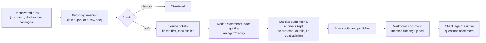

# Knowledge gaps to articles

**Status:** implemented (Module 13, second part, in the
[implementation plan](../../IMPLEMENTATION_PLAN.MD#157-module-13---knowledge-base-quality-loop),
18 November 2026) and evaluated (26 November 2026; see [Evaluation](#evaluation)).
Document freshness, the last part of Module 13, isn't built yet.

When the assistant can't answer a question, it says so and offers a person. That is the
right behaviour, but the question comes back every time someone asks it. Often an agent
has already answered it on a ticket. This feature finds those questions, groups them,
and drafts a knowledge-base article from the agents' replies, with every sentence
checked against the reply it came from. An admin edits the draft and publishes it.

## How it works

### 1. Finding gaps (no model)

**Find gaps** collects every question from the last 90 days (`GAP_LOOKBACK_DAYS`) that
went unanswered:

- **Which answers count:** the evidence policy abstained, the model said the passages
  don't answer, or nothing was found to answer from.
- **Where they come from:** the Ask page, ticket reply suggestions, and the customer
  assistant.
- **What is left out:** escalations (the documents disagree, which the
  [contradiction scanner](contradiction-scanner.md) handles), clarifying questions, and
  runs with an `origin` (rechecks and evaluation probes, which aren't people's
  questions).

Questions are identified by their text (case, spacing and trailing punctuation
ignored) and compared by the cosine similarity of their embeddings:

- **New phrasings join an existing gap.** A new question joins the gap whose weighted
  centroid is most similar, if the similarity reaches `GAP_JOIN_SIMILARITY`. So gaps
  keep their identity across analyses, and an admin's decision sticks. A dismissed gap
  quietly collects new phrasings. A published gap that keeps collecting them shows "N
  questions still unanswered".
- **The rest form new gaps.** They are grouped by average-linkage clustering at
  `GAP_CLUSTER_SIMILARITY`. Average linkage merges two groups only if their questions
  are similar on average. A chain of loosely related questions doesn't collapse into
  one gap, as it would with single linkage.
- **Each gap is named by its most asked question.**

At most `GAP_MAX_NEW_QUESTIONS` (300) new questions are grouped per analysis, most asked
first. The rest wait for the next one.

### 2. Drafting (one gap, model)

**Draft article** on a gap does the following:

1. **Source tickets.** Only resolved or closed tickets with a public agent reply count.
   Internal notes are never used. A ticket's opening message is always the customer's
   question, even when an agent logged the ticket for them.
   - *Linked* tickets come first: those the questions led to. That means a customer who
     handed off from the assistant, or the ticket a suggestion was drafted for.
   - Then *similar* tickets. A keyword search over subjects and public messages makes a
     shortlist of `GAP_TICKET_CANDIDATES` (30). A ticket is kept when its subject and
     opening message reach `GAP_TICKET_MIN_SIMILARITY` to one of the gap's questions.
   - At most `GAP_MAX_SOURCES` (4) tickets go into the prompt. With none, nothing is
     drafted (`no_sources`) and the model isn't called.
2. **The draft.** One model call with JSON constrained to a schema. It returns:
   - a verdict: do the replies answer the questions?
   - a title;
   - up to 10 statements, each with the ticket it comes from and the sentence of that
     ticket's agent reply it rests on, copied word for word.

   The prompt forbids adding facts and using the customer's message as a source. It
   also forbids names, contact details, order numbers, dates of a case, greetings and
   apologies. Questions and tickets are fenced as data.
3. **Checks on every statement** (`ai_engine/gaps/draft.py`, no model). A statement goes
   into the body only if it passes all of these:
   - **The quote is real.** Its quote is found in that ticket's agent replies, with the
     same tolerant match as the contradiction judge. A wrong ticket number is corrected
     rather than penalized.
   - **The numbers match.** Every number in the statement appears in its quote, so
     "within 30 days" can't become "within 60 days" on the way into the article.
   - **Nothing identifies a person.** The statement mustn't contain any of these:
     - the names or email addresses of the tickets' customers and agents. Full names
       and emails match in any case; single name parts only capitalized, so a customer
       called Will Long doesn't flag every "will";
     - any email address, or any phone number of nine digits or more;
     - an order or ticket reference.
4. **Contradictions with the knowledge base.**
   - **What is checked:** the body so far, against its `GAP_CONFLICT_PASSAGES` (3) most
     similar knowledge-base passages, with the contradiction judge.
   - **When it counts:** only conflicts the judge can quote from both sides, at the
     scanner's minimum confidence.
   - **What happens:** the statement the draft's side was quoted from is left out.
     Agents sometimes repeat an outdated page, and publishing that would create a new
     contradiction. Which side is right is a person's decision.

The draft's status is one of the following:

| Status | Meaning |
| --- | --- |
| `drafted` | At least one statement passed every check |
| `no_sources` | No relevant resolved ticket was found |
| `not_answered` | The tickets don't answer the questions, or nothing passed the checks |
| `failed` | The model couldn't be used; the error is recorded |

Statements that failed a check stay in the record, marked with the reason, so the admin
can see what was left out and why.

### 3. Publishing (admin)

The admin edits the title and text and chooses who the article can answer:

- **internal:** staff only;
- **public:** the customer assistant can answer from it too.

The article becomes a Markdown document (`# Title`, then the text). It is indexed like
any upload, including the indexing-time removal of instructions aimed at an AI. From
then on it is an ordinary document that can be edited, versioned or deleted. The gap
becomes `published`. The audit log records who published it, its visibility, and
whether the draft was edited.

### 4. Checking again

Once the article is indexed, **Check again** asks the gap's most asked questions (up to
`GAP_RECHECK_QUESTIONS`, 10) through the staff answer pipeline. It records for each
question its status before and after, and whether the answer cites the new article.
These runs carry `origin: gap_check`, so they never count as gaps or appear in the
analytics gap list.

## Jobs

Analyses, drafts and rechecks run in a worker (`knowledge_gaps.run`), one at a time per
organization (a partial unique index on running jobs). That keeps drafts from occupying
the local model in parallel. A second request gets `409 job_running`. If the queue is
down, the job is recorded as failed and the request returns `503`. There is no schedule
yet: an admin presses **Find gaps** (it takes seconds and makes no model call).

## Reviewing gaps

**Knowledge base → Gaps** has two views:

- **The list:** gaps most asked first, with their questions and the draft's status.
- **A gap's page:**
  - every question, with where it was asked, its linked tickets and its latest run;
  - the source tickets;
  - each statement with its quote, marked kept or left out, and why;
  - any contradiction with a document;
  - the editor;
  - after publishing, the article's state and the recheck.

Admins draft, publish, dismiss, reopen and recheck. Agents can read. Customers can't see
gaps (RLS).

## Settings

| Variable | Default | Meaning |
| --- | --- | --- |
| `GAP_LOOKBACK_DAYS` | 90 | Window of unanswered questions |
| `GAP_JOIN_SIMILARITY` | 0.8 | A new question joins the closest gap at this similarity or more |
| `GAP_CLUSTER_SIMILARITY` | 0.8 | New questions are grouped at this average similarity or more |
| `GAP_MAX_NEW_QUESTIONS` | 300 | New questions grouped per analysis |
| `GAP_TICKET_CANDIDATES` | 30 | Tickets shortlisted by the keyword search |
| `GAP_TICKET_MIN_SIMILARITY` | 0.7 | A similar ticket must reach this similarity to one of the questions |
| `GAP_MAX_SOURCES` | 4 | Tickets in the drafting prompt |
| `GAP_CONFLICT_PASSAGES` | 3 | Knowledge-base passages the draft is checked against; 0 skips the check |
| `GAP_RECHECK_QUESTIONS` | 10 | Questions asked again after publishing |

## API

All under `/api/v1/knowledge/gaps`, in the organization in `X-Organization-Id`.

| Method and path | Who | What |
| --- | --- | --- |
| `GET /summary` | staff | Gaps by status, drafts ready, distinct questions, the latest job and analysis |
| `POST /analyses` | admin | Group unanswered questions (`202`; `409 job_running`; `503`) |
| `GET /` | staff | Gaps, most asked first; filter by `status` |
| `GET /{id}` | staff | One gap with all its questions, sources, draft, article and recheck |
| `POST /{id}/drafts` | admin | Draft (or redraft) its article (`202`; `409 gap_not_open`) |
| `POST /{id}/publish` | admin | `{"title", "body", "visibility"}`: publish as a document (`409 duplicate` if identical to an existing one) |
| `POST /{id}/rechecks` | admin | Ask its questions again (`202`; `409 not_published`, `article_not_indexed`) |
| `PATCH /{id}` | admin | `{"status": "dismissed" \| "open", "note"}` (audited) |

## Evaluation

`uv run python -m app.cli evaluate-gaps --name g1-g3 --regression` (from `backend/`) runs
experiments G1-G3 on `datasets/knowledge_gaps/`. The write-up is
[`experiments/reports/knowledge-gaps-g1-g3.md`](../../experiments/reports/knowledge-gaps-g1-g3.md).
In short:

- **Effect:** publishing the drafts unedited made 10 of 20 held-out paraphrases correctly
  answerable, up from 0 (checked by hand; exact McNemar p = 0.002).
- **Safety:** no customer detail or outdated claim reached an article.
- **Regression:** none on the benchmark's test split.
- **Grouping:** 0.75 was chosen on the dev topics. The defaults above are still the
  provisional 0.8.
- **Faults found:**
  - the number check treats the digit in a product name ("Q3") as a number;
  - the conflict check removes a correct statement when the knowledge-base side is the
    outdated FAQ;
  - the drafting model misreads "we don't offer that" as no answer, and keeps an agent's
    "I'll find out" as a fact.

## Limitations

- **The agents' replies are the ceiling.** A draft can only be as right as the replies it
  comes from. The checks ensure it says what an agent said, not that the agent was
  right. Only the contradiction check catches a reply that disagrees with a document.
  An admin's review is the real safeguard, and the editor says so.
- **The privacy check is pattern-based.** It finds the tickets' people by name and email,
  and common shapes of contact details and references. A customer detail in another
  shape, such as a street address or a device serial number, isn't caught by a pattern.
  The prompt also tells the model to leave such details out.
- **One language.** Questions in other languages group and match by the English
  embedding model only as well as it handles them.
- **No schedule.** Gaps are found when an admin asks.
